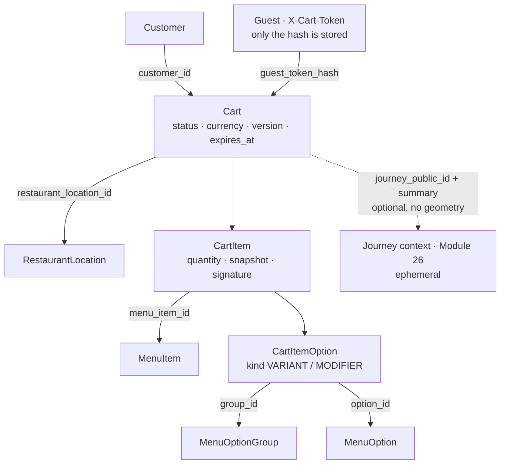

# Cart: guest and customer carts, customization validation, server-authoritative pricing (Module 27)

What a customer intends to order, kept and priced by the backend. A cart belongs to **one restaurant location**, is
owned by a guest (an opaque token) or a signed-in customer, and is compared with the current menu and restaurant on
every read. Nothing is ordered here: pickup time (Module 28), checkout, taxes, fees and promotions (Module 29),
payment (Module 30) and orders (Module 31) are not part of a cart.

Local development only — nothing here has touched production.

## The rule

```
ONE ACTIVE CART  =  ONE RESTAURANT LOCATION
```

An item of another restaurant — another outlet of the same organization included — is refused with
`409 cart_restaurant_conflict`. The cart is replaced only by `POST /cart/switch-restaurant`, which the customer
confirmed; nothing destructive ever happens on its own. Both halves are enforced in the database as well (see
"Database").

## Vocabulary

| Term | What it is | Where |
|---|---|---|
| **Cart** | The items of one owner at one restaurant location: currency, version, lifetime, status, optional journey link. | `carts`, `App\Models\Cart` |
| **CartItem** (line) | A menu item in ONE configuration — selected options + special instructions — and a quantity. Carries a snapshot of the name and prices the customer saw. | `cart_items`, `App\Models\CartItem` |
| **CartItemOption** | One selected option of a line, as a row: the real menu group and option, `kind` (VARIANT / MODIFIER), and the names and adjustment the customer saw. | `cart_item_options` |
| **Signature** | `sha256(item id \| sorted option ids \| normalized instructions)`: two lines with the same signature are the same line. | `CartSignature` |
| **CartOwner** | Who a request is made by: a customer, a guest holding a token, or nobody. Every cart query goes through it. | `CartOwner`, middleware `cart.owner` |
| **Guest token** | `gc1.<issued>.<256 random bits>.<HMAC tag>` — minted and signed by the server, sent as `X-Cart-Token`. Only its SHA-256 hash is stored. | `GuestCartToken` |
| **CartInspection** | The cart as the backend sees it NOW: every line priced from the current menu, every issue, the subtotal, the verdict. | `CartValidationService`, `CartInspection` |
| **CartIssue** | Something found by that comparison (`ITEM_SOLD_OUT`, `PRICE_CHANGED`, …) with a severity: BLOCKING, REVIEW or INFO. | `CartIssueCode` |
| **Journey link** | A reference to the Module 26 journey the cart was started from plus a display summary — labels and figures, never coordinates or a route. | `CartJourneyLink` |

## Domain diagram



## Ownership and security

- **Customer cart**: `customer_id`. One ACTIVE cart per customer, the same on every device. Signing out leaves it
  with the account; whoever uses the device next is a guest and cannot reach it.
- **Guest cart**: the SHA-256 hash of the guest token. The token is minted by the server (`GET /cart` hands one to a
  caller who has neither a session nor a usable token; a first change without any identity does too), signed with a
  key derived from `APP_KEY` — so the backend only ever works with tokens it issued — and is *stateless until the
  first item*: issuing a token creates nothing. It travels in the `X-Cart-Token` header only, never in a URL, and is
  never logged. A token may START a cart for 30 days after it was issued; an existing cart keeps answering to it.
- **No route takes a cart id.** `cart.owner` decides whose cart a request is about; a line id is looked up inside
  that cart only. Another guest, another customer, restaurant staff and administrators get `404` (or an empty cart)
  — there is no cart listing for staff or administrators at all. Administrators see **counts** (`GET
  /admin/system/carts`), never contents.
- **A signed-in customer is the customer**: a guest token sent along is ignored, except by `POST /cart/claim`.
- **Clients decide nothing about money or state**: `price`, `unit_price_minor`, `subtotal*`, `currency`,
  `customer_id`, `status`, `version`, `restaurant_location_id`, `expires_at` … are refused with `422` (not ignored).
  The models are fully guarded; every write goes through `CartService` / `CartClaimService`.
- **Special instructions** are untrusted plain text: control characters are removed, white space collapsed, the
  length bounded (`menu.limits.instructions`, 200). Markup is not interpreted anywhere — clients render the value
  as text — so it is kept as written, not refused. A note never changes a price.
- **Logs**: cart events are logged with the cart id, the owner TYPE, the restaurant id and counters — never the
  token, the items, the instructions or anything about the journey.
- **Rate limits** (per minute): `cart-read` 120; `cart-write` 60 for a customer, 40 for a guest address; at most 10
  NEW guest carts per address (`rate_limits.cart_create_guest`).

## Status and lifetime

| Status | Meaning |
|---|---|
| `ACTIVE` | The owner's current cart (at most one). |
| `EXPIRED` | Nobody touched it for its lifetime. |
| `ABANDONED` | Its owner ended it: cleared it (`cleared`), replaced it with a cart of another restaurant (`restaurant_switch`), or chose the other cart at sign-in (`discarded_at_sign_in`, `replaced_at_sign_in`). |
| `INVALIDATED` | Its lines were merged into the customer's cart at sign-in (`merged`). |
| `CONVERTED` | An order was created from it — reserved for Module 31; never deleted by the cleanup. |

- A guest cart lives **7 days** after its last change, a customer cart **30 days** (`config/cart.php`, environment).
  Every change renews the lifetime; reading does not.
- Past that instant the cart answers `status: EXPIRED` with `CART_EXPIRED`: it still shows what was in it, refuses
  every change with `410 cart_expired`, and is left through `DELETE /cart` (or a confirmed switch). The next item
  starts a new cart.
- `php artisan carts:prune` (hourly): carts past their lifetime **and** a 24-hour grace are closed as `EXPIRED`;
  closed carts older than 30 days are deleted with their lines. `CONVERTED` carts are never touched.
- An **empty** cart stays `ACTIVE` until it expires; having nothing to lose, it is simply re-pointed when the next
  item comes from another restaurant.

## Pricing

```
item base price + variant adjustments + modifier adjustments = unit price
unit price × quantity                                         = line subtotal
sum of the lines that can be ordered                          = cart subtotal
```

Integer minor units in the currency of the restaurant location (INR for the India launch; nothing in the cart
domain names a currency). The calculation is Module 24's `MenuPricingService` — the single place a configured item
price is worked out — wrapped by `CartPricingService` for the cart's error vocabulary, the currency rule and the
subtotal (`Money` refuses to add two currencies). **No tax, fee, tip or discount is part of a cart subtotal.**

A line keeps the price the customer saw (`snapshot`) only as display context and as the baseline of "the price
changed"; the price that counts is recalculated from the menu on every read.

## Validation

`CartValidationService::inspect()` runs on every read and before every later step:

| Checked | Issue code | Severity |
|---|---|---|
| cart past its lifetime | `CART_EXPIRED` | BLOCKING |
| restaurant no longer visible to customers (suspended, not approved, market off) | `RESTAURANT_UNAVAILABLE` | BLOCKING |
| restaurant paused / pickup off / area paused | `RESTAURANT_NOT_ACCEPTING` | BLOCKING |
| restaurant closed right now | `RESTAURANT_CLOSED_NOW` | INFO — the pickup time is chosen in Module 28 |
| no active menu | `MENU_UNAVAILABLE` | BLOCKING |
| menu changed since the cart was last written (`catalog_version`) | `MENU_CHANGED` | INFO |
| currency of cart, location, menu or a line differ | `CURRENCY_MISMATCH` | BLOCKING |
| linked journey ended | `JOURNEY_STALE` | INFO |
| item sold out / temporarily unavailable / switched off / removed | `ITEM_SOLD_OUT`, `ITEM_TEMPORARILY_UNAVAILABLE`, `ITEM_DISABLED`, `ITEM_REMOVED` | BLOCKING |
| a chosen option or its group no longer selectable | `OPTION_UNAVAILABLE` (names in `details.options`) | BLOCKING |
| a group became required / min not met | `REQUIRED_CUSTOMIZATION_MISSING` | BLOCKING |
| max exceeded, combination no longer valid | `INVALID_CUSTOMIZATION` | BLOCKING |
| quantity outside the item's bounds | `QUANTITY_LIMIT` | BLOCKING |
| current unit price ≠ snapshot | `PRICE_CHANGED` (`previous_unit_price_minor`, `current_unit_price_minor`) | REVIEW |

Verdict: `INVALID` when anything is BLOCKING, else `NEEDS_REVIEW` when something is REVIEW, else `VALID`;
`can_proceed` = ACTIVE, not empty and VALID. **Nothing is removed or silently repaired**: a line that cannot be
ordered stays in the cart with its issue and is left out of the subtotal (`included_in_subtotal: false`); a changed
price is shown next to the price that counts. `POST /cart/refresh` is the customer's "update my cart": lines that
can be priced today get today's prices as their new baseline.

Adding is allowed while the restaurant is closed or paused (people order ahead of a journey); what is not orderable
at that moment is reported and decided at pickup / checkout. The item's own state is enforced at once: a sold-out
item or an unavailable option cannot be newly added.

The whole comparison loads the menu rows of all lines in bulk: **24 queries for a cart of 1 line and for a cart of 20
lines** (`CartPerformanceTest`).

## API

All under `/api/v1`, open to guests and customers (`customer.optional` + `cart.owner`). Every answer is
`{ "cart": {…} | null }` plus, where it applies, `line`, `replaced`, `result`, `claim`, `guest_token`.

| Method | Path | Purpose |
|---|---|---|
| GET | `/cart` | The caller's cart with its validation, or `cart: null`. Issues a guest token to a caller without identity. |
| POST | `/cart/items` | Add an item: `restaurant_id`, `item_id`, `selections[{group_id, option_ids}]`, `quantity`, `special_instructions`, optional `journey_id`, `cart_version`. `201`. |
| PATCH | `/cart/items/{line}` | Quantity, selections and / or instructions of a line. An equal configuration merges into the other line. |
| DELETE | `/cart/items/{line}` | Remove a line (the cart stays). |
| DELETE | `/cart` | End the cart. Safe to repeat. |
| POST | `/cart/refresh` | Accept the current prices as the new baseline. |
| POST | `/cart/switch-restaurant` | `confirm: true`, `restaurant_id`, optional `item`: close the cart and start one of the other restaurant, atomically. |
| PUT / DELETE | `/cart/journey` | Link the cart to one of the caller's own living journeys on purpose / remove the link. |
| POST | `/cart/claim` | Signed-in customers: take over the guest cart named by `X-Cart-Token`; optional `resolution`. |
| GET | `/admin/system/carts` | Counts for administrators (`admin.system.view`). |

Errors use the platform envelope `{error: {code, message, details, request_id}}`:

| HTTP | `code` | When |
|---|---|---|
| 404 | `restaurant_not_found`, `item_not_found` | Restaurant not visible to customers; item not on that restaurant's active menu (also an item of another restaurant). |
| 404 | `cart_not_found`, `cart_line_not_found` | No cart to change; a line that is not in the caller's cart (also somebody else's). |
| 409 | `cart_restaurant_conflict` | Item of another restaurant. `details.current` / `details.requested` (a summary — never item names). |
| 409 | `cart_version_conflict` | `cart_version` is stale. `details.current_version`. |
| 409 | `item_unavailable`, `option_unavailable`, `restaurant_unavailable`, `currency_mismatch` | Sold out / unavailable; a chosen option not selectable; a change to a cart whose restaurant is gone. |
| 409 | `cart_merge_conflict` | Sign-in: two carts of different restaurants. `details.guest`, `details.account`, `details.resolutions`. |
| 410 | `cart_expired` | Any change to an expired cart. |
| 422 | `invalid_customization` | Required group missing, min / max, option under the wrong group, unknown group (`details.issues`). |
| 422 | `quantity_limit`, `cart_line_limit`, `validation_failed` | Quantity above the item's maximum (never capped quietly); too many lines; malformed or forbidden input. |
| 429 | `rate_limited` | A limit above. |

OpenAPI: `backend/openapi/openapi.json` (`Cart`, `CartLine`, `CartIssue`, `CartEnvelope`, `CartChangeResult`,
`CartClaimResult`, `CartMetrics`, …), enforced by `CartOpenApiContractTest`.

## Concurrency, versions, idempotency

- Every change runs in one transaction with the owner's ACTIVE cart row **locked** (`SELECT … FOR UPDATE`) and
  raises `version`. Two simultaneous changes are applied one after the other, never interleaved.
- Two simultaneous *first* adds of one owner both try to create the cart; the partial unique index lets one win,
  the other runs again and finds it (`CartStore::transaction`). Result: one cart, one line, both quantities.
- A client may send `cart_version` (the version it last saw): stale → `409 cart_version_conflict`. Without it the
  change applies to whatever is there.
- `Idempotency-Key` (optional): scoped to the cart owner (`customer:{id}` / `guest:{hash}`) and the operation, bound
  to the request body, kept 24 hours (Module 20's `idempotency_keys`). The same key + the same request replays the
  first answer (`Idempotency-Replayed: true`); the same key + another request is `409 idempotency_key_reused`. A
  request with no identity at all cannot be scoped and is passed through.
- No distributed lock and no cart cache: the row lock is enough, and a cached cart could outlive a menu change.
  Redis is used by the cart for rate limits and the event counters only.

## Guest → customer (sign-in)

`CartClaimService` — one policy, on the backend, so the web and the Android app cannot differ:

1. The guest has no cart, an empty one or an expired one → nothing to claim.
2. The customer has no cart (or an empty / expired one) → the guest cart **becomes** the customer's cart.
3. Both have items from the **same** restaurant location → merged into the customer's cart: a guest line with the
   same signature raises that line's quantity up to the item's maximum (a capped quantity is reported in
   `claim.adjusted`, never applied silently); every other guest line moves over as its own line; a living journey
   link of the guest cart is taken over.
4. Both have items from **different** restaurants → `409 cart_merge_conflict`; both carts stay untouched until the
   customer chooses `keep_guest` or `keep_account`.

The guest cart is claimed with its **token**, in the session of the customer who just signed in — never with a cart
id. The token is spent by the claim (`spent_token_hash`): it never addresses a cart again.

## Journey

- `journey_id` sent with an item links the cart to that journey when the cart has no living link; the journey must
  be the caller's own and alive (a guest proves it with `X-Journey-Token`). A cart already linked to another living
  journey keeps it — `PUT /cart/journey` changes that on purpose.
- Stored: the journey's public id and a summary — the two place **labels**, whether the restaurant lies inside the
  journey's corridor and how far from the route (PostGIS), and the detour and arrival **when route discovery had
  already calculated them**. Never coordinates, addresses or geometry; never an estimate in place of a missing figure.
- A journey expires after 30 minutes and is pruned. The cart stays usable; its journey block turns `STALE`
  (`JOURNEY_STALE`, INFO) and the old figures are no longer presented as current.

## Database

- `carts`: `carts_one_active_per_customer` and `carts_one_active_per_guest` (partial unique indexes on ACTIVE
  carts); checks for status, currency format, "at most one owner", "an ACTIVE cart has an owner", "closed ⇔
  `closed_at`"; `restaurant_location_id NOT NULL` with `ON DELETE RESTRICT`.
- `cart_items`: `UNIQUE (cart_id, signature)`; `quantity BETWEEN 1 AND 1000`; `menu_item_id … ON DELETE RESTRICT`.
- `cart_item_options`: `UNIQUE (cart_item_id, option_id)`; group and option `ON DELETE RESTRICT`.
- Menu rows are archived, never hard-deleted (Module 24): archiving an item leaves the line in place, and the cart
  reports `ITEM_REMOVED`.
- Indexes for every lookup (`CartPerformanceTest::test_every_lookup_of_the_cart_domain_has_an_index`).

## Events and numbers

`CartCreated`, `CartItemAdded`, `CartItemUpdated`, `CartItemRemoved`, `CartCleared`, `CartRestaurantConflict`,
`CartRestaurantSwitched`, `CartClaimed`, `CartMerged`, `CartMergeConflict`, `CartRevalidated`, `CartExpired` — product
events, not audit events. `RecordCartEvent` turns each into a counter (hour buckets, 48 h) and one log line.
`GET /admin/system/carts` reports active / guest / customer carts, carts awaiting cleanup, closed carts by outcome and
those counters.

## Clients

| | Customer Web | Android |
|---|---|---|
| Switch | `VITE_CART_MODE=api` | `--dart-define=CART_MODE=api` |
| Guest token | `localStorage` (`fotg.cart.token`), header only | secure storage (`fotg.cart.token`), header only |
| Cart badge | total quantity (`item_count`) | total quantity |
| No connection | "We could not load your cart" — unknown, not empty | the last cart the backend sent is shown, marked, and cannot be changed |
| Retry | one retry with the SAME idempotency key | one retry with the SAME idempotency key |

Both ask the customer before a restaurant switch and at a two-restaurant sign-in, show issues line by line, and take
every amount from the backend. Pickup time, checkout, payment and orders after the cart are still development data.

## Hand-over to the next modules

- **Module 28 (pickup)** uses the cart's restaurant location, the journey link's arrival, the restaurant's hours and
  preparation settings.
- **Module 29 (checkout)** consumes a cart whose validation is `VALID`, revalidates it once more, and adds taxes,
  fees and promotions — none of which exist in a cart.
- **Module 31 (orders)** moves the cart to `CONVERTED` and snapshots what was sold.

## Tests

`tests/Feature/Cart` (12 files), `tests/Unit/Cart`: API, pricing, customization, validation state, the restaurant
rule, ownership / IDOR, sign-in claim and merge, versions and idempotency, journey link, expiry and cleanup,
fixtures and counters, N+1 and indexes, the OpenAPI contract.

## Not in this module

Pickup slots and availability, checkout, taxes, fees, promotions, payments, orders, order notes, saved carts, cart
sharing, support tooling that reads a customer's cart.
