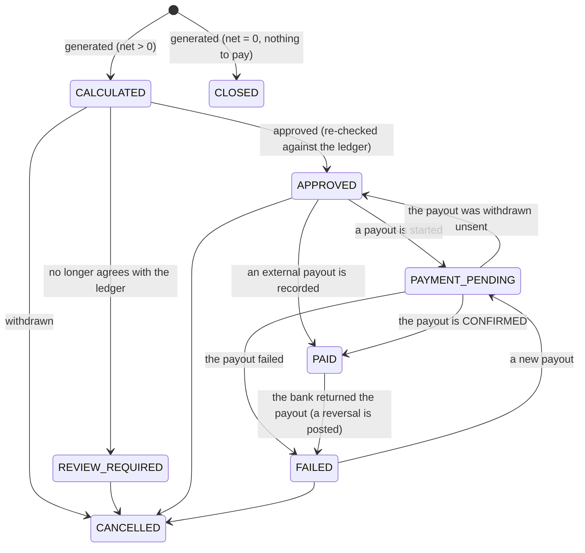
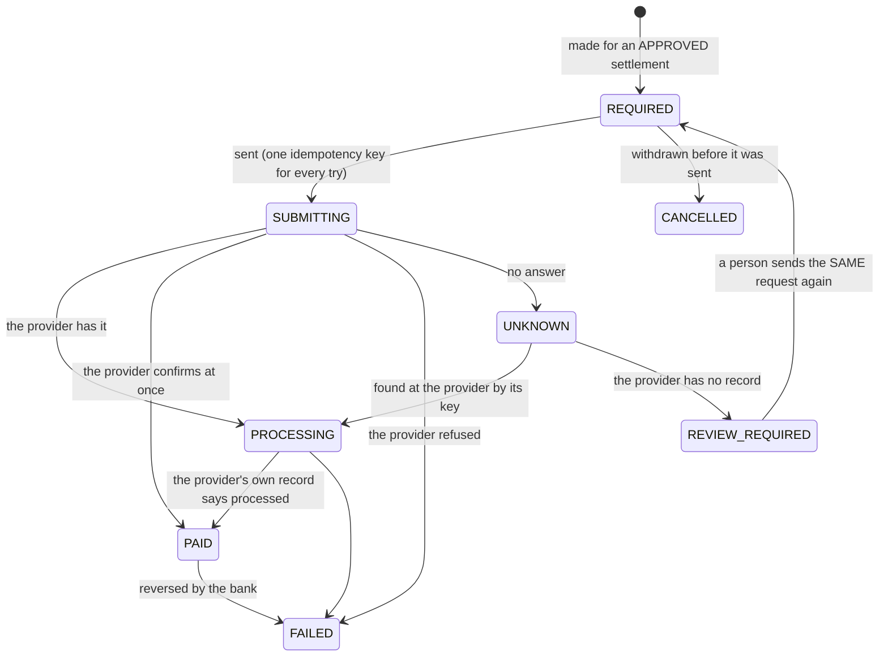
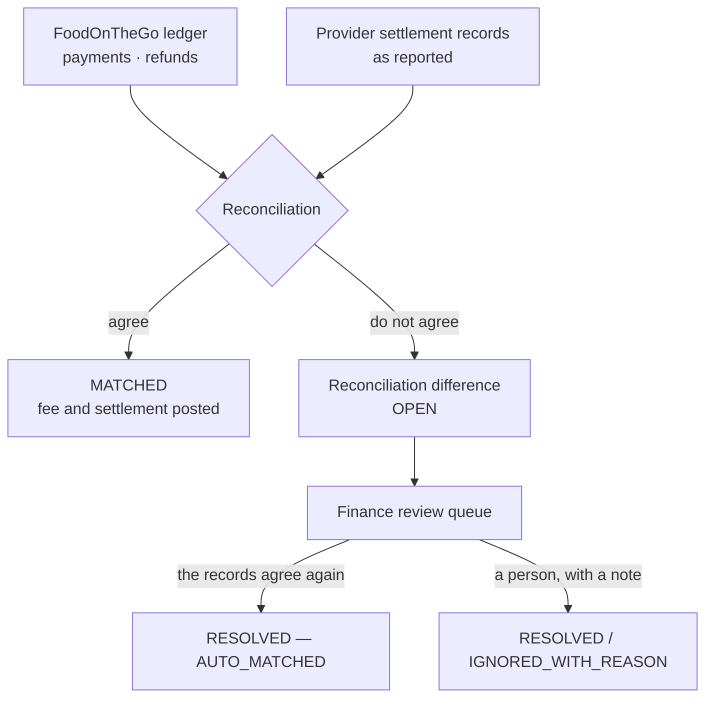

# Finance (Module 36) — ledger, commission, restaurant earnings, settlements, payouts, reconciliation

Built 2026-10-12, local only. Laravel 13.35 / PHP 8.3 / PostgreSQL 18 (the spec says 12 / 16 — CF-268).

Customer payments, platform revenue and restaurant earnings are **three different things**. This module keeps them
apart in a double-entry ledger, calculates what each restaurant is owed, states it in settlement statements, tracks the
payout of each statement and compares the platform's records with the payment provider's.

**What is real and what is not.**

| | State |
|---|---|
| Ledger, commission engine, allocations, earnings, holds, adjustments, settlements, reconciliation, reporting | Built and tested on this machine (PostgreSQL) |
| Restaurant payout **domain** (model, idempotency, unknown outcome, webhook, reconciliation, external record) | Built and tested on the development `FakePayoutProvider` — no money moves |
| **LIVE RESTAURANT PAYOUTS** | **DISABLED / NOT APPROVED.** No real payout adapter exists |
| Provider settlement import | Built on the fake provider; the Razorpay reader is tested on a faked HTTP layer only — **PENDING PROVIDER VERIFICATION** (no credentials on this machine, CF-404) |
| Commission rate, its base, tax ownership, fee ownership, refund liability, provider-fee allocation, settlement schedule, minimum payout, GST / TDS / TCS, tax invoices, credit notes | **PENDING BUSINESS / FINANCE / TAX / LEGAL APPROVAL** — configuration exists, no value is approved |
| Restaurant KYC / bank onboarding / linked accounts | Not built. Nothing is faked |

Every rate in a test, a seed or a screenshot is a **TEST FIXTURE**. `1000 basis points = 10 %` is the specification's
example for a development test; it is not FoodOnTheGo's commission and no code knows the number.

## Provider documentation reviewed

Reviewed on **2026-10-12** on razorpay.com/docs (REST API v1; no SDK is used).

| Topic | What the documentation says | What this module does with it |
|---|---|---|
| Settlements API | `GET /v1/settlements`, `GET /v1/settlements/:id`, `GET /v1/settlements/recon/combined?year&month[&day][&count ≤ 1000][&skip]`; basic auth with key id + secret | The reader in `RazorpayPaymentProvider` (`lines()`, `settlements()`) — the only class that may hold the credentials. Faked HTTP only |
| Settlement entity | `id`, `amount` (subunits), `status` created / processed / failed, `fees`, `tax`, `utr`, `created_at` | Stored as reported in `provider_settlements` |
| Reconciliation line | `entity_id`, `type` payment / refund / transfer / adjustment, `debit`, `credit`, `amount`, `currency`, `fee`, `tax`, `on_hold`, `settled`, `created_at`, `settled_at`, `settlement_id`, `payment_id`, `settlement_utr` | Stored as reported in `provider_settlement_items`; card, bank and customer fields are never kept |
| Fees | payment `fee` = "Fee (including GST) charged by Razorpay", `tax` = "GST charged for the payment" | The ONLY source of provider fees. Nothing is calculated from a price list |
| Schedule | T+2 working days for domestic payments; settled after deducting fees; refunds reduce the balance | "Missing at the provider" is reported after a configurable number of days (default 5 — a development default) |
| Route (linked accounts, transfers) | Needs RBI eligibility and a written use-case confirmation reviewed by Razorpay | Not used. **PENDING PROVIDER ACCOUNT ENABLEMENT** |
| RazorpayX payouts | A separate product and account; IP allow-list; idempotency key mandatory since 2025-03-15 | Not used. No payout adapter is written |
| NOT confirmed on the pages read | the payout idempotency header's name, payout / settlement / transfer webhook event names, test-mode differences | Nothing is assumed: no Razorpay payout adapter and no Razorpay settlement webhook exist |

## The ledger

PostgreSQL is the source of truth. Redis holds locks, queues and short-lived counters — never a balance.

| Table | What it is |
|---|---|
| `ledger_accounts` | A code, ONE currency and an owner (the platform, a restaurant location, a provider). No balance column: a balance is the sum of its entries |
| `ledger_transactions` | One financial event, once (`posting_key` is unique), with the record it is about (`source_type`, `source_id`) |
| `ledger_entries` | The debits and credits of a transaction: positive amounts, the currency of the transaction AND of the account |

**CODE INVARIANTS** (enforced by `LedgerPostingService` and again by the database):

- a transaction has a source, at least two lines, one currency, and debits = credits — a deferred constraint trigger refuses the commit otherwise;
- an entry's currency is its transaction's and its account's (two composite foreign keys): INR and USD cannot meet;
- `UPDATE` and `DELETE` on a posted transaction or entry are refused by a trigger. A correction is a NEW transaction (`reverse()` posts the exact opposite, once);
- the same business event posts once: a repeated event, a retried job or two workers return the transaction that exists;
- **no route writes the ledger** — three read-only `GET` routes exist. There is no `POST /ledger-entry`, no balance edit, no "mark as paid".

| Account | Side | Holds |
|---|---|---|
| `PAYMENT_CLEARING` | credit | customer money received and not yet anybody's |
| `PROVIDER_CLEARING` (per provider) | debit | what the payment provider holds for the platform |
| `RESTAURANT_PAYABLE` (per location) | credit | what the platform owes the restaurant |
| `PLATFORM_COMMISSION_REVENUE`, `PLATFORM_FEE_REVENUE` | credit | the platform's revenue |
| `PROMOTION_EXPENSE` | debit | discounts the platform pays for |
| `TAX_LIABILITY` | credit | tax collected and not passed to a restaurant |
| `REFUND_CLEARING`, `DISPUTE_CLEARING` | debit | money that went back to a customer, until somebody decides who bears it |
| `PLATFORM_REFUND_EXPENSE`, `PLATFORM_DISPUTE_EXPENSE` | debit | what the platform bore |
| `PROVIDER_FEE_EXPENSE`, `PROVIDER_TAX_EXPENSE` | debit | the provider's reported fees and the tax in them |
| `PAYOUT_CLEARING` | credit | money sent to restaurants |
| `PLATFORM_BANK` | debit | what the provider settled to the platform |
| `PLATFORM_ADJUSTMENTS` | debit | the other side of a manual adjustment |

## When money is recognized (the timing policy)

| Event | Posting key | Posting |
|---|---|---|
| Payment `VERIFIED` | `payment:{id}:verified` | Dr `PROVIDER_CLEARING` / Cr `PAYMENT_CLEARING` |
| Order created | — | the allocation is frozen (no posting) |
| Order `COMPLETED` | `order:{id}:recognized` | Dr `PAYMENT_CLEARING` total, Dr `PROMOTION_EXPENSE` platform-funded discount / Cr `RESTAURANT_PAYABLE` net, Cr commission, Cr platform fees, Cr tax held |
| Order rejected / cancelled | — | the allocation is void; the money goes back through a refund |
| Refund `REFUNDED` | `refund:{id}:completed` | Cr `PROVIDER_CLEARING`; Dr `PAYMENT_CLEARING` (order never recognized) or Dr `REFUND_CLEARING` |
| Refund liability decided | `refund:{id}:liability` | Dr `RESTAURANT_PAYABLE` restaurant's share, Dr `PLATFORM_REFUND_EXPENSE` platform's share / Cr `REFUND_CLEARING` |
| Dispute `LOST` | `dispute:{id}:lost` (+ `:liability`) | as a refund, through `DISPUTE_CLEARING` |
| Provider fee (matched line) | `provider-item:{provider}:{type}:{ref}:fee` | Dr `PROVIDER_FEE_EXPENSE` + `PROVIDER_TAX_EXPENSE` / Cr `PROVIDER_CLEARING` |
| Provider settlement received | `provider-settlement:{provider}:{ref}:received` | Dr `PLATFORM_BANK` / Cr `PROVIDER_CLEARING` |
| Payout `PAID` | `payout:{id}:paid` | Dr `RESTAURANT_PAYABLE` / Cr `PAYOUT_CLEARING` |
| Payout returned by the bank | `payout:{id}:reversed` | the exact opposite, as a new transaction |
| Manual adjustment | `adjustment:{id}` | `RESTAURANT_PAYABLE` against `PLATFORM_ADJUSTMENTS` |

Recognition at completion (not at payment or creation) is **POLICY — PENDING BUSINESS APPROVAL**; it is the only
trigger built, and it keeps a restaurant from being paid for an order that was never handed over.

Events are posted by a queued job (`finance` queue) after the commit of the payment, order or refund change; the
scheduled sweep `finance:post-pending` finds whatever has no posting. Neither the payment, the order nor the refund
path waits for the ledger or can fail because of it.

## The formula

```
customer total   = merchandise − discount + tax + fees                        CODE INVARIANT (the order's own check)
discount         = restaurant-funded part + platform-funded part              POLICY: the promotion's funding source
commission base  = merchandise [− restaurant discount [− platform discount]]  POLICY: the plan's base policy
commission       = commission base × rate, rounded half up to the minor unit  POLICY: the plan's rate; CODE INVARIANT: integer arithmetic
restaurant net   = merchandise − restaurant discount − commission
                   [+ tax when the tax is the restaurant's] [+ fees when the fees are the restaurant's]   POLICY: owners
platform net     = commission + the platform's fees − platform-funded discount
```

| Policy | Where | Value today | Approval |
|---|---|---|---|
| Commission rate and base | `commission_plans` | TEST fixtures only | PENDING BUSINESS APPROVAL |
| Promotion funding | `promotions.funding_source`, frozen on the allocation | per promotion | PENDING BUSINESS APPROVAL |
| SHARED promotion split | `FINANCE_SHARED_PROMOTION_RESTAURANT_BPS` | undefined → the order waits for a decision | PENDING BUSINESS APPROVAL |
| Tax owner | `FINANCE_TAX_OWNER` | `UNASSIGNED` (held in `TAX_LIABILITY`) | PENDING TAX / LEGAL APPROVAL |
| Fee owner | `FINANCE_FEE_OWNER` | `PLATFORM` | PENDING BUSINESS APPROVAL |
| Provider fees | `finance.provider_fees.policy` | `PLATFORM_BORNE` (the only policy built) | PENDING BUSINESS APPROVAL |
| Refund liability per reason | `FINANCE_REFUND_LIABILITY` | `UNASSIGNED`: a person decides each refund | PENDING BUSINESS / LEGAL APPROVAL |
| Holds on open refunds / disputes | `FINANCE_HOLD_ON_*` | on | PENDING BUSINESS APPROVAL |
| Settlement cadence, time zone, scope | `finance.settlements.*` | WEEKLY, the market's time zone, per location | PENDING BUSINESS APPROVAL |
| Minimum payout | `FINANCE_MINIMUM_PAYOUT_MINOR` | none | PENDING BUSINESS APPROVAL |
| Four-eyes | `FINANCE_*_FOUR_EYES` | off | PENDING BUSINESS APPROVAL |

Commission never applies to tax or to customer fees: no base policy includes them. No GST rate, no TDS / TCS rate and
no withholding rule exists anywhere in the code.

## Commission plans

`commission_plans`: a percentage in basis points with an explicit base, for a market, an organization or a location,
between two moments. The most specific plan wins (location → organization → market). A plan is **never edited**:

- a new plan starts in the future — it can never reach back over orders already placed — and ends the plan that was open for the same scope at that moment;
- a plan that has started can only be ended at a future moment; one that has not started can be withdrawn;
- every change records who, the old and new values, the effective date and the reason;
- `approval = TEST` plans are never applied in production; `APPROVED` needs the reference of its approval.

An order's allocation carries the plan, its version, the rate, the base policy, the base and the amount it was
allocated with. Changing a plan changes no order. **No plan → no commission calculation at all**: the allocation is
`REVIEW_REQUIRED` (never 0 %) until a person decides the terms of that one order, with a reason.

## Allocations, payable lines, holds

`order_financial_allocations` — one per order, made when the order is created from the order's own columns; statuses
`PENDING` → `RECOGNIZED` / `VOID`, or `REVIEW_REQUIRED`. Never recalculated.

`restaurant_payable_items` — the restaurant's sub-ledger: `ORDER_EARNING`, `REFUND_ADJUSTMENT`, `DISPUTE_ADJUSTMENT`,
`MANUAL_ADJUSTMENT`. Each line mirrors a ledger posting, has a signed amount that never changes, and is consumed by
exactly one settlement (`settlement_id`).

`financial_holds` — a line or a whole location kept out of settlements and payouts: `REFUND_PENDING`, `DISPUTE`
(placed and released by the system), `COMPLIANCE`, `RECONCILIATION`, `MANUAL_REVIEW` (placed by a person, with a note).
A hold moves nothing in the ledger. Nothing is held for a number of days.

`financial_adjustments` — who bears a completed refund (`REFUND_LIABILITY`), who bears a lost dispute
(`DISPUTE_LIABILITY`), or a manual correction (`MANUAL`): permission, reason, supporting reference, audit and one
balanced posting. The restaurant's side becomes a **new** payable line.

What a restaurant sees: **pending** (orders placed, not completed — not earned), **available**, **held**,
**in settlement**, **paid out** (confirmed payouts only) and the ledger **balance**.

## Restaurant settlements

A settlement is a calculation of what is owed for a period — it is not a payout, not a provider settlement and not a
tax invoice.



- one settlement per location and currency; the cutoff is midnight of the **market's** time zone (India: `Asia/Kolkata`), stored in UTC;
- every eligible line is taken exactly once: the lines are locked, an advisory lock serializes a location, and a line carries the settlement that took it;
- the totals are the sums of the lines (`restaurant_settlement_lines`, immutable — a trigger refuses changes) and the database checks the statement's own arithmetic;
- a **negative** total is never a settlement, a payout or a bank debit: the lines are carried forward and finance is told (`NEGATIVE_RESTAURANT_BALANCE`, FINANCE REVIEW REQUIRED);
- a **zero** total is a `CLOSED` statement; no minimum payout exists;
- approval re-verifies the lines against the payable lines and the ledger; an approved settlement is never edited — it is withdrawn and generated again, or an adjustment goes into the next one;
- a refund after the payout changes nothing of the past: the restaurant's share is a new negative line for a later settlement.

## Restaurant payouts

**LIVE PAYOUT = DISABLED.** `PAYOUT_DRIVER` is `fake` (development, refused in production) or empty; no real adapter
exists and `finance.payouts.live_enabled` is `false` in code.



- the amount is the settlement's net payable — no request carries an amount that is used;
- one payout is alive per settlement (row lock + a partial unique index);
- a submission without an answer is `UNKNOWN` and is **not sent again**: the provider is asked what it has for the key;
- `PAID` is the provider's own record (a webhook is only a reason to look), or an external payment recorded with its bank reference, day, amount confirmation, reason and evidence;
- a payout webhook is verified by signature, counted once by its event id and can never set a state by its body;
- no bank account number, IFSC, UPI id or KYC document is stored: a payout profile is a provider's token and a mask.

## Provider settlements and reconciliation

Three different things: a **provider settlement** (what the payment provider settled to the platform), a **restaurant
settlement** and a **restaurant payout**.



- a provider record is one row however often it is read; a record that comes back changed is a difference, never an overwrite;
- difference types: `MISSING_INTERNAL_PAYMENT`, `MISSING_PROVIDER_PAYMENT`, `AMOUNT_MISMATCH`, `CURRENCY_MISMATCH`, `MISSING_REFUND`, `MISSING_PROVIDER_REFUND`, `REFUND_AMOUNT_MISMATCH`, `FEE_MISMATCH`, `SETTLEMENT_TOTAL_MISMATCH`, `UNKNOWN_REFERENCE`, `PROVIDER_RECORD_CHANGED`; internal: `PAYMENT_ORDER_AMOUNT_MISMATCH`, `PAYMENT_ORDER_CURRENCY_MISMATCH`, `ORDER_WITHOUT_PAYMENT`, `ORPHAN_PAYMENT`, `REFUND_EXCEEDS_PAYMENT`, `PAYOUT_SETTLEMENT_MISMATCH`, `MISSING_LEDGER_POSTING`, `LEDGER_IMBALANCE`, `PAYABLE_MISMATCH`, `CLEARING_INVERTED`, `NEGATIVE_RESTAURANT_BALANCE`, `ALLOCATION_REVIEW_REQUIRED`;
- a difference is closed automatically only by the rule that found it; a person closes one with a resolution and a note (audited); a `CRITICAL` one cannot be ignored;
- fees are posted from the provider's own figures, for matched lines only; a settlement is posted as received only when it reconciles.

## Commands and schedule

| Command | Does | Schedule |
|---|---|---|
| `finance:post-pending [--backfill]` | posts what has no posting; `--backfill` works through everything and records the counts | every minute |
| `finance:verify-ledger` | integrity: balanced, single currency, no duplicate or orphan postings, payables agree with the ledger, no inverted clearing account | hourly |
| `finance:reconcile-internal` | payments / orders / refunds / payouts / postings against each other | hourly |
| `finance:reconcile-provider [--day=] [--no-import]` | imports the provider's settlement records and reconciles | daily when `FINANCE_PROVIDER_RECONCILIATION_SCHEDULED` |
| `finance:generate-settlements [--until=] [--location=] [--dry-run]` | calculates settlements; a dry run writes nothing | daily when `FINANCE_SETTLEMENTS_SCHEDULED` |

A queue worker must listen on `finance` (e.g. `--queue=orders,payments,notifications,finance`).

## APIs and permissions

Restaurant (read-only, `restaurant.finance.view` per location; another restaurant's data is 404):
`GET /restaurant/finance/summary | earnings | earnings/export | settlements | settlements/{id} | settlements/{id}/export | payouts | terms`.
The payout destination (a mask) needs `restaurant.payout_account.view` (the owner). Customers have no finance API.

Administrators (`/admin/finance/…`, each permission per market):

| Permission | Opens |
|---|---|
| `admin.finance.view` | overview, reports, payables, allocations, adjustments, holds, runs |
| `admin.finance.commission.view` / `.manage` | commission plans (confidential: not part of `finance.view`) |
| `admin.settlements.view` | settlements |
| `admin.finance.settlements.manage` / `.approve` | generate, withdraw / approve |
| `admin.finance.payouts.view` / `.execute` / `.record_external` | payouts / start, retry, reconcile, withdraw / record an external payment |
| `admin.finance.reconciliation.view` / `.manage` | provider settlements, differences / import, checks, closing a difference |
| `admin.finance.adjustments.create` | liability decisions, manual adjustments, an order's missing terms |
| `admin.finance.holds.manage` | place and release holds |
| `admin.finance.ledger.view` | the ledger (read-only) |
| `admin.finance.export` | CSV |

`FINANCE_ADMIN` holds all of them; `OPERATIONS_ADMIN` and `ANALYST` read; `SUPPORT_ADMIN` holds none.
`GET /admin/system/finance` (`admin.system.view`) reports health without calling anything healthy that is not.

CSV exports are scoped, bounded (92 days, 5000 lines), audited and protected against spreadsheet formula injection:
a cell that begins with `=`, `+`, `-`, `@`, a tab or a carriage return and is not a plain number is written with a
leading apostrophe.

## Tax and accounting

Nothing here is a tax or accounting statement. A settlement statement is **not** a tax invoice; a commission invoice
and a credit note are not produced; no GST, TDS or TCS rate exists. Each is **PENDING TAX / ACCOUNTING DESIGN** and a
professional tax review. Direct bank reconciliation, FX and a period close are out of scope.

## Local development

`php artisan db:seed --class=LocalFinanceFixtureSeeder` adds TEST commission plans (India 10 %, Brew & Bites 8 %) and
fake payout destinations. Development simulators (never registered in production): `POST /dev/payouts/{payout}/simulate`,
`POST /dev/finance/payout-profiles`, `POST /dev/finance/provider-settlements`.
