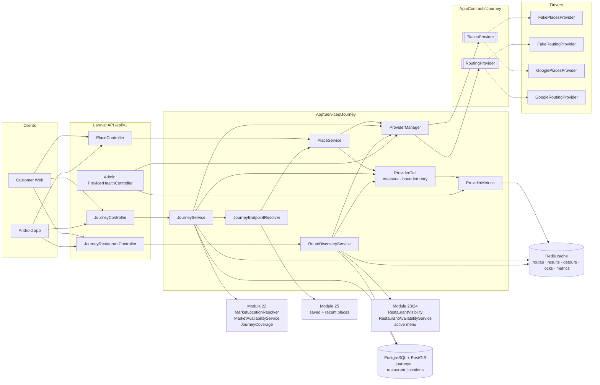

# Journey, routing and route-based restaurant discovery (Module 26)

The differentiator of FoodOnTheGo on the backend: a traveller gives a start, a destination and (optionally) a
departure time; the platform plans the route with a routing provider, finds the restaurants inside a corridor around
that route with PostGIS, asks the routing provider for the **actual** detour of that bounded shortlist only, estimates
when the traveller would reach each restaurant, and answers which restaurants are open — in the restaurant's own time
zone — at that moment. Nothing is ordered, reserved or navigated here: no cart, no order, no pickup slot and no
turn-by-turn directions belong to this module.

Local development only — nothing here has touched production, and no live places / routing provider is configured
on this machine: every journey so far was planned on the **development providers** (see "Providers").

## Vocabulary

| Term | What it is | Where |
|---|---|---|
| **NormalizedLocation** | One shape for "a place": WGS84 coordinates plus optional formatted address, country, region, locality, postal code, time zone and provider place id. It is the Module 22 `Location` — there is no second format. Only the coordinates decide anything. | `App\Support\Geo\Location` |
| **JourneyEndpoint** | One end of a journey after the server resolved it: a `Location`, a label, its source (`place`, `saved_location`, `coordinates`) and, for a place, the provider and its id. | `App\Services\Journey\JourneyEndpoint` |
| **RouteGeometry** | The line a route follows: positions in GeoJSON order (`[longitude, latitude]`, SRID 4326) and the encoded polyline, whatever the provider returned. | `App\Services\Journey\Data\RouteGeometry` |
| **RoutePlan** | A driving route as the platform understands it: distance (m), duration (s), geometry, legs, flags (`TOLLS`, `FERRY`), warnings, provider name, whether the duration considers traffic, when it was calculated. | `App\Services\Journey\Data\RoutePlan` |
| **JourneyContext** | The stored, **expiring** search context: both ends, departure, the normalized route, the coverage answer, the search defaults, its owner. Table `journeys`, model `Journey`. | `App\Models\Journey` |
| **RestaurantRouteCandidate** | A restaurant on the shortlist of one journey: distance to the route, progress along it (0 = start, 1 = destination), segment, detour, leg to the restaurant, arrival, open / orderable at arrival, preparation minutes. An array in the cached candidate set. | `RouteDiscoveryService::compute()` |
| **DetourResult** | The actual detour of one waypoint: `origin → restaurant → destination` minus the base route, plus the first leg `origin → restaurant`. `OK`, `NO_ROUTE` or `FAILED`; null figures mean the provider did not answer — they are never replaced by an estimate. | `App\Services\Journey\Data\DetourResult` |
| **ArrivalEstimate** | `departure + leg(origin → restaurant)`, reported in UTC and in the restaurant's time zone (`local_time`, `local_date`), always flagged `is_estimate`. | `JourneyRestaurantResource` |

## Architecture



The core depends on two interfaces only — `PlacesProvider` (`search`, `resolve`) and `RoutingProvider` (`route`,
`detours`). There is deliberately **no** "maps service" that does both: places and routing are configured, measured,
rate limited and replaced independently (`services.places.*`, `services.routing.*`). Adding a vendor is one driver
class per interface in `ProviderManager`.

## Data flow of one journey

```mermaid
sequenceDiagram
    autonumber
    participant C as Client
    participant API as API
    participant PG as PostGIS
    participant RP as Routing provider
    participant Cache as Cache

    C->>API: POST /journeys/plan  {origin, destination, departure_at?}
    API->>API: resolve both ends on the server (place id / saved place / coordinates)
    API->>PG: market + coverage of both ends (Module 22)
    API->>RP: base route origin → destination   (route cache first, privacy-safe hash)
    API->>PG: ST_MakeValid / ST_IsValid / length / simplify → LineString 4326
    API->>PG: INSERT journeys (expires in 30 min)
    API-->>C: 201 journey + route (+ guest_token once, for a guest)

    C->>API: GET /journeys/{id}/restaurants?sort&filters   (X-Journey-Token)
    API->>Cache: candidate set for journey + candidate filters?
    alt not calculated yet
        API->>PG: 1 corridor — pieces of the route ⋈ restaurant_locations (ST_DWithin, GiST)
        API->>PG: 2 eligibility — visible, serviceable, active menu, cuisine / feature / pickup / text
        API->>API: 3 bounded selection — per segment, round robin, ≤ candidate cap
        API->>Cache: detours this journey already has
        API->>RP: ACTUAL detours of the missing shortlist only (batches of 25)
        API->>API: arrival = departure + leg; open at arrival in the restaurant's time zone
        API->>Cache: candidate set (5 min) + detours per journey
    end
    API->>API: detour limit, "open at arrival", ordering, page
    API->>PG: re-read the page's restaurants: still visible? state at arrival now?
    API-->>C: 200 page + meta (provider, cached, counts, empty_reason)
```

### Straight-line distance is only a shortlist; the detour is the provider's

`ST_DWithin` on the geography column and `ST_Distance` to the route say how far a restaurant is **as the crow
flies**. That is good enough to decide which restaurants are worth asking about, and useless as an answer: a
restaurant 80 m from the carriageway may be on the far side of a divided highway (a long detour through the next
interchange) or behind a river with no bridge (no detour at all). So:

- PostGIS answers **which** restaurants are near the route (shortlist), how far (`distance_to_route_meters`) and
  where along it (`route_progress`).
- The routing provider answers **how long the detour really is** — `origin → restaurant → destination` minus the base
  route — for the bounded shortlist only. The list is filtered and ordered by that figure, never by the straight line.
- A restaurant the provider cannot reach (`NO_ROUTE`) is left out and counted (`counts.unreachable`); a provider
  failure is an error for the traveller (`503 routing_temporarily_unavailable`), never a fabricated detour.

Tests: `RouteDiscoveryApiTest` — opposite carriageway, barrier, detour scenarios A / B / C.

## The pipeline in detail

`JourneyService::plan()`:

1. **Ends.** Each end is exactly one of `place_id` (resolved again by the places provider — the client's text and
   coordinates are never trusted), `saved_location_id` (the signed-in customer's own Module 25 place; the server reads
   its coordinates) or `lat` + `lng` (+ optional label). Two forms at once is a validation error.
2. **Same point.** Ends closer than `journey.geometry.same_point_meters` (50 m) are refused (`422`).
3. **Departure.** ISO 8601 with an offset; absent = now. Up to 10 minutes in the past is treated as now (clock skew),
   more is refused, as is more than 14 days ahead.
4. **Market.** `JourneyCoverage::endpoints()` (Module 22): both ends must lie in a market that serves customers —
   otherwise `422 market_unsupported` with `end` and `reason`; two different markets → `422
   cross_border_unsupported`. Country is never hard-coded: the country the places provider is restricted to comes
   from the market configuration.
5. **Base route.** From the route cache when the same rounded ends, preferences and departure bucket were planned in
   the last 5 minutes, otherwise from the routing provider through `ProviderCall` (measured, retried for transient
   failures only). No route → `422 route_not_found`. A straight line is never drawn in its place.
6. **Geometry.** The provider's line becomes a PostGIS `LineString` in SRID 4326. It is rejected when invalid, has
   fewer than two points or no length (`503`, logged as `journey.route_geometry_rejected`). Above `max_points` (2000)
   a topology-preserving simplification (25 m) is stored as the **search** geometry; the full line is kept for display.
7. **Coverage along the route.** `COVERED` or `NO_SERVICE_COVERAGE` with the number of serviceable areas the corridor
   touches. A route with no served area is still a valid journey — its restaurant list is an empty **answer**.
8. **Store.** One row in `journeys`, expiring after `journey.ttl_minutes` (30). For a guest the response carries
   `guest_token` exactly once.

`RouteDiscoveryService::search()`:

1. **Corridor (SQL, one statement, parameterized).** The search geometry is cut into compact pieces (`ST_Segmentize`
   at 2 km, `ST_Subdivide` at 5 vertices) inside a `MATERIALIZED` CTE; each piece probes the GiST index of
   `restaurant_locations.location` with `ST_DWithin(location, piece, corridor)`. Rows are grouped per restaurant and
   limited by `journey.candidates.sql_limit` (2000, a safety valve). Compact pieces keep every index probe's bounding
   box tight whatever the direction of the route — one bounding box around a diagonal 250 km route would cover a
   large part of the market.
2. **Eligibility (Eloquent on the id list).** Market active; organization and location approved and visible
   (`RestaurantVisibility::scopeVisible`); the location's service area serves customers at the expected time
   (`whereServiceableAt`); an **active menu** exists (`journey.eligibility.require_active_menu`); then the cheap
   filters — cuisine and feature codes, pickup method, text. A restaurant is never a candidate because it is near.
3. **Bounded selection (PHP).** The route is cut into segments of 25 km; each segment keeps at most
   `max(per_segment_cap, candidate_cap / segments)` candidates, closest first, taken round robin across segments up
   to `candidate_cap` (default 40, market-configurable, platform maximum 100). Long routes are therefore represented
   along their whole length instead of exhausting the cap near the start. Duplicates cannot occur (grouped by id).
4. **Detours.** Detours this journey already has (`journey:{id}:detours`, plain rows, 5 minutes) are reused — a
   detour depends on the journey and the restaurant, not on the filters or the corridor width. Only restaurants not
   yet calculated go to the provider, in batches of `detour_batch_size` (25). A guard throws before the call if more
   waypoints than the candidate cap would be sent, and `rate_limits.journey_detours` (12 per minute **per journey**)
   stops one journey from becoming a stream of provider calls (`429`). `FAILED` results are never cached.
5. **Arrival and opening.** `arrival = departure + leg_to_restaurant`. `RestaurantAvailabilityService::evaluate()`
   is asked for that instant: weekly hours, special days, overnight periods, closures, pause, pickup switched off —
   in the restaurant's own time zone (which may differ from the traveller's).
6. **Result filters and ordering** (applied to the cached candidate set, no recalculation): maximum detour, "open at
   arrival", then one of `recommended` (orderable at arrival, open at arrival, detour, progress), `lowest_detour`,
   `route_order`, `nearest_to_route`, `fastest_pickup`. Every ordering ends in a deterministic tie-break.
7. **Page and freshness.** The page's restaurants are re-read with the visibility rules and re-evaluated at arrival:
   a restaurant suspended, hidden or paused since the calculation is dropped or shown with its current state
   (`counts.dropped_since_calculation`). Paging never calls the routing provider.

`meta.empty_reason` tells an empty list apart: `NO_SERVICE_COVERAGE` (no served area along the route),
`NO_RESTAURANTS_IN_CORRIDOR`, `NO_REACHABLE_RESTAURANTS` (the provider found no drivable way), `FILTERS`.

## API

All under `/api/v1`, public with an optional customer session (`customer.optional`): a guest and a signed-in
customer use the same endpoints. Coordinates travel in request **bodies** only — never in a URL.

| Method | Path | Purpose | Rate limit (per minute) |
|---|---|---|---|
| GET | `/places/search?q=` | Suggestions of the places provider, restricted to the market's country. Text only — no coordinates. | `places-search`: customer 60, guest 30 |
| POST | `/places/resolve` `{place_id}` | Coordinates, time zone and the coverage answer for one suggestion. | `places-search` |
| POST | `/journeys/plan` | Plans the route and stores the expiring journey. `201` with the journey; for a guest also `guest_token` (once). | `journey-plan`: customer 12, guest 6 |
| GET | `/journeys/{id}` | The journey, for its owner only. Never returns the token. | `journey-read`: 120 |
| GET | `/journeys/{id}/restaurants` | Restaurants along the journey: `sort`, `corridor_width_meters`, `max_detour_minutes`, `open_at_arrival`, `cuisine`, `feature`, `pickup_method`, `q`, `page[number]`, `page[size]`. | `journey-read`: 120; new detour calculations 12 per journey |
| GET | `/admin/system/providers` | Provider configuration and health for administrators (`admin.system.view`, platform-wide). | — |

Fields a client may never set on `POST /journeys/plan` are refused, not ignored: `customer_id`, `market_id`,
`market_status`, `provider`, `provider_mode`, `route`, `status`, `expires_at`, `guest_token`, `eligible`.

Errors use the platform envelope `{error: {code, message, details, request_id}}`:

| HTTP | `code` | When |
|---|---|---|
| 422 | `validation_failed` | Ambiguous end, same point, bad coordinates, departure without an offset / out of range, forbidden field, unknown saved place |
| 422 | `invalid_location` | The provider refused a location as unusable |
| 422 | `market_unsupported` | An end lies outside every market that serves customers (`details.end`, `details.reason`) |
| 422 | `cross_border_unsupported` | The two ends are in different markets |
| 422 | `route_not_found` | No road route between the ends |
| 404 | `place_not_found` | Unknown place id |
| 404 | `journey_not_found` | Unknown journey — **or not the caller's** (indistinguishable on purpose) |
| 410 | `journey_expired` | The journey's lifetime is over (answered until the row is pruned) |
| 429 | `rate_limited` | A limit above; `Retry-After` and `details.retry_after_seconds` |
| 503 | `routing_temporarily_unavailable` / `places_temporarily_unavailable` | Provider timeout, outage or misconfiguration (`details.retry_after_seconds` 15) |
| 503 | `provider_rate_limited` | The provider's own quota (`details.retry_after_seconds` 30) |

A route with no served area is **not** an error: `200` with an empty list and `empty_reason: NO_SERVICE_COVERAGE`.

OpenAPI: `backend/openapi/openapi.json` (paths above; schemas `PlaceSuggestion`, `ResolvedPlace`, `Journey`,
`JourneyRestaurantPage`, `RouteContext`, `ProviderHealth`, …), enforced by `JourneyOpenApiContractTest`.

## Ownership, expiry and privacy

- **Owner.** A journey belongs to the signed-in customer who planned it, or to a guest. A guest journey is readable
  only with the token issued when it was planned: 64 hex characters from `random_bytes(32)`, stored as a SHA-256 hash
  (`guest_token_hash`), sent as the `X-Journey-Token` header (allowed in CORS), never accepted in a URL and never
  returned again. Knowing the UUID is not enough. A customer journey is read with the account session; another
  customer, a guest, restaurant staff and administrators get `404`.
- **Ephemeral.** `expires_at = created + 30 min`. After that the API answers `410` for a grace period
  (`prune_grace_minutes`, 60), then `journeys:prune` (hourly, `routes/console.php`) deletes the row. There is no
  journey history: nothing lists a customer's past journeys, and the clients keep "recent journeys" only for the
  browser tab / the run of the app.
- **Recent places.** Only a place a signed-in customer **searched for and chose** is recorded in their Module 25
  recent places (bounded, deduplicated, clearable, pruned). A raw position — the device's "current location" or a
  pin — and a saved place are used for the journey and never copied there. Places of a live provider are not
  recorded until that provider's storage terms are confirmed (`journey.record_recent_live_places`, default off).
- **Logs.** `journey.planned`, `journey.discovery`, `journey.provider_failed` carry identifiers, market, provider,
  outcome, counts and timings — never an origin, a destination, an address, a label, a coordinate or a polyline. The
  route cache key is a SHA-256 hash of rounded coordinates, provider, preferences and departure bucket; the cached
  value is the provider's answer without the two places.
- **Cache.** Nothing but plain arrays is cached. `config/cache.php` keeps `serializable_classes` false (no PHP class
  is unserialized from the cache), so a cached object would come back unusable on Redis; the test suite runs its
  array store with serialization on (`CACHE_ARRAY_SERIALIZE`, `phpunit.xml`) so this fails in tests, not at runtime.
- **Device location.** Asked for by the client only when the traveller taps "Use my current location"; sent in the
  request body as coordinates; used for that journey only.

## Providers

| | Development (`fake`) | Google (`google`) |
|---|---|---|
| Places | `FakePlacesProvider`: deterministic Indian places (plus a few foreign ones to test the country boundary) | `GooglePlacesProvider`: Places API (New) text search + place details, field masks, country restriction |
| Routing | `FakeRoutingProvider`: a synthetic road model — known corridors through via-points, islands without a route, detours derived from the base route (nearest point × 1.3 access factor, 30 km/h, + 60 s) | `GoogleRoutingProvider`: Routes API `computeRoutes` + `computeRouteMatrix` (two matrix calls per detour batch) |
| Status here | **In use locally.** Journeys carry `provider.mode = development` and every client labels the figures accordingly ("development routing model — synthetic roads, not real road data"). | **Implemented, contract-tested against recorded HTTP shapes only. BLOCKED / PENDING PROVIDER CONFIGURATION: no credentials exist, no live call has been made, nothing here is real-provider verified.** |

Configuration (environment only — never in the repository, never logged, never sent to a client):

```
PLACES_DRIVER=fake|google        ROUTING_DRIVER=fake|google
PLACES_API_KEY=                  ROUTING_API_KEY=
JOURNEY_ALLOW_FAKE_PROVIDERS=    # default: true outside production, false in production
```

- The fake providers are refused wherever `journey.providers.allow_fake` is false: production cannot silently plan
  journeys on synthetic roads — a `fake` driver there is a `MISCONFIGURED` failure (`503`, logged as
  `journey.provider_misconfigured`), as is an unknown driver or a missing key.
- Every provider call has an explicit timeout (`services.*.timeout`), bounded retries with growing back-off and jitter
  for **transient** failures only (timeout, 5xx, connection), and maps the vendor's errors onto `ProviderFailure`.
- `ProviderMetrics` counts calls, failures, timeouts, quota events, "not found" answers and latency per capability and
  driver in one-minute buckets. Health (`OPERATIONAL`, `DEGRADED`, `OUTAGE`, `UNKNOWN`) is **derived from the
  platform's own calls** over the last 10 minutes — `UNKNOWN` until something was called. No cost is shown: there is
  no billing data to base one on. Administrators see it on System Status (`GET /admin/system/providers`).

Before a live provider is switched on (owner decisions, tracked in the master tracker): choose the vendor, create the
account and keys, confirm its terms for storing place data and caching routes, set quotas and budget alerts, then run
the live-provider end-to-end checks.

## Market policy

`market_configurations.journey` (JSON, administrators with the market permission): `corridor_width_meters`,
`max_detour_minutes`, `candidate_cap` — each clamped to the platform bounds in `config/journey.php`. The journey
resource publishes the effective values under `search` so clients offer only what the backend accepts.

## Performance

Measured on this development machine (PostgreSQL 18 + PostGIS 3.6, local Redis for the HTTP figures, no OPcache);
measurements, not targets. Evidence: `docs/local-review/test-results/m26-performance.json`,
`m26-http-timings.json`.

**Scale test** (`RouteDiscoveryScaleTest`): 20,000 eligible restaurants spread over about 195 km × 220 km, a
197 km route (Noida → Agra, 38 search points), test database, PHP CLI without OPcache, development
routing provider (no network). Figures of one run in a warm process:

| Step | Measured |
|---|---|
| Corridor statement (as executed by the request) | 22.92 ms |
| Corridor statement, `EXPLAIN (ANALYZE, BUFFERS)` — execution / planning | 28.278 ms / 0.328 ms; index `restaurant_locations_location_gist` |
| Eligibility query on the id list | 5.75 ms |
| Restaurants in the corridor → shortlist → sent to the provider | 458 → 40 → 40 in 2 batches; 8 route segments represented |
| `POST /journeys/plan` (whole request) | 31.4 ms |
| First `GET …/restaurants` (corridor + eligibility + detours + arrival) | 186.1 ms |
| A further page (from the calculated set) | 48.4 ms |
| First plan + search of a fresh PHP process (loads the framework) | 241.1 ms |

Three consecutive runs gave 160–190 ms for the first search, 23–38 ms for the plan and 36–57 ms for a cached page.

**Over HTTP** (browser suite, 5 runs each: `php artisan serve` behind the local proxy, Redis cache, the six-restaurant Noida
fixture; every request pays about 0.3 s for booting the framework without OPcache — see the place search, which does no
routing work at all):

| Request | Median | Min – max |
|---|---|---|
| `POST /journeys/plan` | 402 ms | 359 – 580 ms |
| First `GET …/restaurants` | 506 ms | 436 – 613 ms |
| Cached page | 470 ms | 416 – 552 ms |
| `GET /places/search` | 347 ms | 303 – 547 ms |

No figure here involves a live provider: with one, the provider's own latency (one route call per plan, two matrix
calls per detour batch) is added to the plan and to the first search.

Design points behind those numbers:

- GiST on `restaurant_locations.location` (geography) is used by every corridor probe; the scale test asserts the
  index in the plan without planner hints. Planner statistics matter: `ANALYZE` after bulk loads.
- The corridor statement is one round trip whatever the route length; eligibility is one query on the id list; the
  number of queries of a discovery request does not grow with the number of candidates (asserted).
- One calculation per journey + candidate filters at a time (`Cache::lock`): concurrent first reads wait for it and
  reuse it — verified across two API processes.
- Provider calls per first search: one base route at planning, then `ceil(shortlist / 25)` detour batches; a cached
  page makes none.

## Tests

`backend/tests/Feature/Journey/`: `PlacesApiTest`, `JourneyPlanApiTest`, `JourneyAccessTest`,
`RouteDiscoveryApiTest`, `JourneyEdgeCasesTest`, `ProviderContractTest`, `ProviderHealthApiTest`,
`RouteDiscoveryScaleTest`, `JourneyOpenApiContractTest` (shared builders in `tests/Support/BuildsJourneys.php`).
End-to-end on the real local stack: `docs/local-review/test-results/m26-web-e2e.json` (Customer Web) and
`m26-android-preview-e2e.json` (the Android app's code as a Flutter web preview — not a device test).

## Not in this module

Cart, orders, payment, pickup slots, slot reservation, turn-by-turn navigation, live traffic re-routing, map tiles
(the clients draw the provider's line in a schematic view — map provider integration is pending), reviews and ratings
(no rating is shown along a journey), saved journey history.
