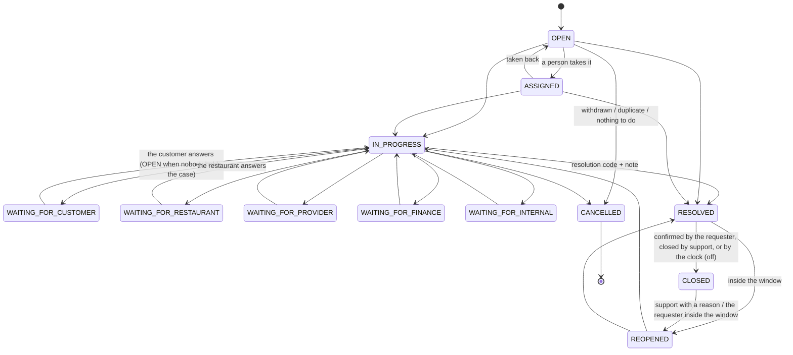
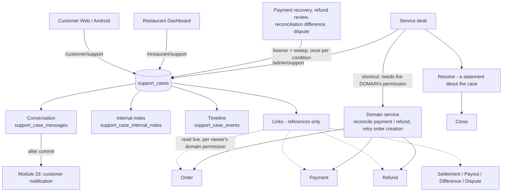

# Support cases (Module 37)

Customer support, restaurant support, the administrators' service desk and the cases the system opens by itself —
**one case domain** (`support_cases`) seen through three scoped surfaces.

Local development only. Nothing here has touched production. Every operating value (priorities, routing, reopen
windows, SLA targets) is a DEVELOPMENT DEFAULT, PENDING BUSINESS APPROVAL; no value is a commitment to a customer or
a restaurant.

## 1. The rule everything follows

A support case **describes, coordinates and investigates**. It never decides what is true about the thing it is
about.

| The case says | The truth lives in |
|---|---|
| "Payment appears stuck" | the payment attempt (Module 30) |
| "The customer says the refund has not arrived" | the refund (Module 35) |
| "The restaurant says the order was handed over" | the order and its pickup verification (Modules 31 / 32) |
| "Why is the payout lower?" | the settlement and the payout (Module 36) |

Consequences, each enforced in code and tested:

- A case holds **references** to records (`support_case_links`: the record's key and the name it had when it was
  linked) and **no copy of their state**. The panels of a case read the linked records live, every time.
- **Closing, resolving, reopening or cancelling a case changes no order, payment, refund, settlement or payout.**
  A refund that becomes REFUNDED does not close its case either: a case is ended by a person.
- A resolution code is a statement about the case. `REFUND_COMPLETED` is accepted only when a linked refund is
  `REFUNDED` in its own domain (409 `resolution_not_supported_by_record` otherwise) — and choosing it refunds nothing.
- Support **cannot mark a payment verified, mark a refund completed, or edit a settlement or a payout**: no route,
  no field and no shortcut does it (`domain_authority` in the case answer says `NOT_PROVIDED` four times).
- A **shortcut** from a case to a domain action (ask the provider about a payment or a refund again, retry the
  creation of an order) runs the domain's own service, writes the domain's own audit record, and needs the
  **domain's own permission** — `admin.support.manage` is never enough (403 `domain_permission_required`).

## 2. Model

| Table | What it is |
|---|---|
| `support_cases` | The case: number, requester, category / subcategory, priority, status, queue and assignee, classification, resolution, internal targets, counters, `version`. |
| `support_case_messages` | The conversation with the requester — EXTERNAL by nature; the only rows a customer or a restaurant reads. |
| `support_case_internal_notes` | What administrators write for each other. **A table of its own**: no requester query can select a note by forgetting a filter. |
| `support_case_events` | The timeline: one numbered line per thing that happened (`sequence` unique per case), `EXTERNAL` or `INTERNAL`, references and codes only — never message text. |
| `support_case_links` | Typed references: one real foreign key per kind (order, payment, refund, settlement, payout, dispute, review, reconciliation difference, location, organization, customer). |
| `support_case_assignments` | Assignment history (routing, a person's decision, an escalation). |
| `support_case_escalations` | Escalations: reason, level, from / to queue, note, who, open or closed. |
| `support_sla_policies` | INTERNAL response / resolution targets by market / category / priority / queue. |
| `support_case_attachments` | Schema only — see §11. |

The database refuses every `UPDATE` of a message, a note or a timeline line (trigger `support_refuse_update`), a case
that is over without saying how it ended, a restricted case without its class, a customer's case without its
customer, a link whose type and record do not match, and a second live system case for the same condition.

**Case number** — `CS-` and eight characters of `ABCDEFGHJKLMNPQRSTUVWXYZ23456789` (no 0 / O / 1 / I). Random, unique
(a constraint; the writer retries a collision), never the key. **It is not an authorization**: every endpoint decides
by who is asking; a case that is not the caller's answers 404 (customers, restaurants) or 403 (administrators).

**Requester types** — `CUSTOMER`, `RESTAURANT`, `ADMIN`, `SYSTEM`; always derived from the caller.
**Sources** — `CUSTOMER_WEB`, `ANDROID`, `RESTAURANT_DASHBOARD`, `ADMIN`, `SYSTEM_ALERT`, `PAYMENT_RECOVERY`,
`REFUND_RECOVERY`, `FINANCE_RECONCILIATION`, `SECURITY`.

### Categories

The taxonomy lives in **one place**, `backend/config/support.php`, and is served by the catalog endpoints; clients
carry no list of their own (labels are client strings).

`ORDER`, `PAYMENT`, `REFUND`, `PICKUP`, `RESTAURANT`, `ACCOUNT`, `PROMOTION`, `REVIEW`, `SETTLEMENT`, `PAYOUT`,
`DISPUTE`, `TECHNICAL`, `SECURITY`, `OTHER` — each with the audiences that may use it, its queue, its starting
priority, an optional restricted class and optional subcategories (`ORDER_DELAYED`, `PAYMENT_CHARGED_NO_ORDER`,
`REFUND_NOT_RECEIVED`, `PICKUP_CODE_ISSUE`, `SETTLEMENT_MISMATCH`, `PAYOUT_PENDING`, …).

- A customer is never offered `SETTLEMENT`, `PAYOUT` or `DISPUTE`; a restaurant never `PAYMENT`, `REFUND` or `DISPUTE`.
- `SETTLEMENT` / `PAYOUT` need `restaurant.finance.view` from a restaurant member.
- `DISPUTE` and the subcategory `RECONCILIATION_DIFFERENCE` are finance-restricted; `SECURITY` is security-restricted.

### Priority and escalation are different things

**Priority** (`LOW`, `NORMAL`, `HIGH`, `URGENT`) says how urgent a case is. It is the backend's — from the category
(configuration) — and changed only by an administrator with a reason. A requester never sets it.

**Escalation** asks another queue or a higher level (`L2`, `L3`) to look, with a reason (`FINANCIAL_RISK`,
`CUSTOMER_IMPACT`, `RESTAURANT_IMPACT`, `SECURITY`, `PROVIDER_ISSUE`, `SLA_RISK`, `MANAGEMENT_REVIEW`, `OTHER`). It
gives the case to that queue and is recorded with who, why and when. It performs **nothing** in the domain the case
is about: a finance escalation asks finance to look — it refunds and pays nothing. A `SECURITY` escalation also makes
the case restricted (possibly out of the escalating person's own sight).

## 3. Case state machine

(Every waiting state can also move to another waiting state, to `RESOLVED` and to `CANCELLED`; they are left out of
the picture for legibility. The allowed-transition table is `SupportCaseStatus::ALLOWED`.)

- The status moves **only** through `SupportCaseStateMachine::move()`; a step that is not allowed is 409
  `case_invalid_transition`. No request carries a status and there is no `PATCH` of a case.
- Every state-changing action of the desk names the `expected_version` it was decided on (409
  `case_version_conflict`). Messages and notes are independent appends and need none — except a reply that also
  makes the case wait (`then`): it is a change of state and carries the version (a retry with the same
  `client_message_id` answers the same message whatever its version). The desk's own summary and follow-up time
  (`annotations`) carry the version and move it.
- A requester reads six words: `OPEN`, `IN_PROGRESS`, `WAITING_FOR_YOU`, `RESOLVED`, `CLOSED`, `CANCELLED`.
- **Resolution codes**: `ANSWERED`, `ORDER_RESOLVED`, `REFUND_COMPLETED`, `PAYMENT_RECONCILED`,
  `RESTAURANT_RESOLVED`, `DUPLICATE_CASE`, `NO_ACTION_REQUIRED`, `USER_WITHDREW`, `ESCALATED_EXTERNALLY`, `OTHER`.
- **Reopen**: the requester inside `SUPPORT_REOPEN_RESOLVED_DAYS` (14) after RESOLVED or `SUPPORT_REOPEN_CLOSED_DAYS`
  (7) after CLOSED, with a message; an administrator at any time with a reason. A cancelled case is never reopened.
- **Closing by the clock** is off: `SUPPORT_AUTO_CLOSE_RESOLVED_DAYS` and `SUPPORT_AUTO_CLOSE_NO_RESPONSE_DAYS` are
  empty until the business sets them.

## 4. Visibility matrix

| | Customer | Restaurant | Support admin | Finance admin | Holder of the security class (only SUPER_ADMIN today) |
|---|---|---|---|---|---|
| External messages of their own / reachable case | yes | yes | yes | yes | yes |
| Internal notes | **never** | **never** | with `admin.support.notes` | with `admin.support.notes` | yes |
| Priority, queue, assignee, escalations | never | never | yes | yes | yes |
| Internal targets (SLA) | never | never | yes | yes | yes |
| Resolution note, administrators' summary | never | never | yes | yes | yes |
| Order panel | own order: number, status, total | order of own location | with `admin.orders.view` | yes | yes |
| Payment details | own: status, amount | never | with `admin.payments.view` (seeded: yes) | yes | yes |
| Refund details | own: status in customer words, amount | never | with `admin.refunds.view` (seeded: yes) | yes | yes |
| Settlement / payout details | never | with `restaurant.finance.view` | **no** (no finance permission) | yes | yes |
| Dispute, reconciliation difference | never | never | no | yes (`admin.disputes.view`, `admin.finance.reconciliation.view`) | yes |
| Finance-restricted cases (`DISPUTE`, differences) | never | never | **no** | yes (`admin.support.restricted.finance`) | yes |
| Security-restricted cases, security notes | own report only (no notes) | own report only | **no** | **no** | yes (`admin.support.restricted.security`) |
| Customer name / masked phone on a case | — | never | with `admin.customers.view` | no | yes |
| Attachments | not built | not built | not built | not built | not built |

A restricted case is absent from lists, queue counts and search for anybody without its class, and answers 403
`case_restricted` by id. **There is no security-administrator role**: only SUPER_ADMIN holds the security class.

## 5. Who may link what

- **Customer**: their own order, payment or refund — by the reference they see. Somebody else's: 404 and no case.
- **Restaurant**: an order, settlement or payout of the location (or organization) the case is for; money records need
  `restaurant.finance.view`. A customer, a payment, a refund or a dispute cannot be linked by a restaurant.
- **Administrator**: any record they may **read in its own domain** for its market (403
  `linked_record_not_authorized` otherwise). A customer only by id — never by name, phone or e-mail.

## 6. Architecture

Services (`backend/app/Services/Support`): `SupportCaseService` (opening, conversation, the desk's actions — one
transaction on the locked case each), `SupportCaseStateMachine` (the only door to a status and the only writer of the
timeline), `SupportLinkService` (who may link what; live summaries per audience; shortcuts),
`SupportDomainActionService`, `SystemCaseService`, `SupportSlaService`, `SupportSweepService`, `SupportCatalog`,
`SupportMetrics`, `SupportText`. Events after commit: `SupportCaseChanged`, `SupportCaseMessageCreated` (an internal
note raises nothing). Listeners: `OpenSystemSupportCases`, `NotifyOnSupportCase`.

## 7. Cases the system opens

| Condition | Key | Category / queue | Opened by |
|---|---|---|---|
| A verified payment that could not become an order (`RECOVERY_REQUIRED`) | `payment-recovery:{payment}` | PAYMENT / PAYMENT_CHARGED_NO_ORDER → PAYMENTS, HIGH | the payment's event + the sweep |
| A refund in `REVIEW_REQUIRED` | `refund-review:{refund}` | REFUND / REFUND_FAILED → PAYMENTS, HIGH | the refund's event + the sweep |
| An open reconciliation difference of at least `SUPPORT_SYSTEM_CASE_DIFFERENCE_SEVERITY` (HIGH) | `finance-difference:{difference}` | SETTLEMENT / RECONCILIATION_DIFFERENCE → FINANCE, finance-restricted | the sweep (the finance domain raises no event) |
| An open provider dispute | `dispute:{dispute}` | DISPUTE → FINANCE, finance-restricted | the sweep |
| A security matter | `security:{key}` | SECURITY → SECURITY, security-restricted | **readiness only** — nothing opens one automatically |

ONE case per key, whatever became of it (a unique index on the key): the listener, the sweep and two workers at once
find the case that exists. A system case writes to nobody, is not shown to the customer or restaurant concerned, and
does nothing to the condition. When a person closes or cancels it while the condition is still there, the sweep does
NOT open it again (it would come back every minute). When the domain REPORTS the condition again by its own event
(a payment needs recovery again, a refund goes to review again), a CLOSED case is reopened with a note; a CANCELLED
one stays cancelled — a person decided it is not a case.

The sweep reads every measured case, a batch after the other, and only the reconciliation differences that are
serious enough — a row that needs nothing can never keep a later row from being seen. A case of the system or of an
administrator has no requester, so no first response is due on it; a reopened case is measured from its reopening.

`php artisan support:sweep` (every minute): missed system cases, SLA states, and the auto-close rules (off).

## 8. Internal targets (SLA)

`support_sla_policies` — the most specific ACTIVE policy that matches a case on market / queue / category / priority
gives it a first-response and a resolution target (elapsed wall-clock minutes). No policy ⇒ `N/A`.

- States: `ON_TRACK`, `AT_RISK` (the configured share of the time is gone, default 80 %), `BREACHED`, `PAUSED`, `N/A`.
- The clock stands still while support waits **for the requester** (a policy flag); waiting for the provider, finance
  or an internal team counts.
- "First response" is the first reply written by a person of support — not a system message.
- A breach, once it happened, stays a breach: answering late or resolving the case does not undo it.
- Automatic escalation on a breach is a switch (`SUPPORT_SLA_AUTO_ESCALATE`), off.

**Not a contract.** The policies on this machine are TEST FIXTURES (`LocalSupportFixtureSeeder`); no target is shown
to a customer or a restaurant, and no response time was approved by the business.

## 9. APIs

Customer — `/api/v1/customer/support` (`auth:customer`): `GET catalog`, `GET cases`, `POST cases`,
`GET cases/{case}`, `GET cases/{case}/messages`, `POST cases/{case}/messages`, `POST cases/{case}/close`,
`POST cases/{case}/reopen`.

Restaurant — `/api/v1/restaurant/support` (`auth:restaurant`): the same eight, scoped by organization and location.

Service desk — `/api/v1/admin/support` (`auth:admin`): `GET catalog | agents | metrics | queues | cases |
cases/{case} | cases/{case}/messages | notes | events | links`; `POST cases`, `POST cases/{case}/messages` (EXTERNAL),
`notes` (INTERNAL), `assign`, `priority`, `start`, `wait`, `resume`, `resolve`, `close`, `reopen`, `cancel`,
`escalate`, `links`, `annotations`, `domain-actions`; and `GET /api/v1/admin/system/support`.

43 routes; none is `PUT` / `PATCH` / `DELETE`. Every body is closed: an unknown field is 422. Opening a case accepts
an `Idempotency-Key`; a message accepts `client_message_id` (a retry writes nothing twice). A reply must say
`visibility: EXTERNAL` and a note `visibility: INTERNAL` — a mismatch is refused, so a client whose composer shows
the wrong mode cannot send through it.

What the screens needed once they were built on these APIs (all additive):

- `POST cases/{case}/close` of a requester REQUIRES an `intent` — `CONFIRM` (only a RESOLVED case) or `WITHDRAW`
  (only a case that is being worked on). It is decided under the lock of the case; when the case is no longer in
  that state the answer is `409 case_changed` in the requester's own words and nothing happens: a confirmation can
  never turn into a withdrawal because support reopened the case in between.
- A requester's `reopen` of a case that is already open again answers `409 case_already_open` (a retry after a lost
  answer is told the truth, not "can no longer be reopened").
- A requester reads a linked **payment** as `VERIFIED`, `FAILED`, `CANCELLED`, `EXPIRED` or `PROCESSING` — the payment
  domain's `UNKNOWN`, `REVIEW_REQUIRED` and its intermediate states all read `PROCESSING` (refunds already used the
  customer's words of Module 35).
- A requester's case detail carries `limits.message_max`; the desk's case carries `can.resume` (a waiting case); the
  desk's catalog carries `can.create` (may open an internal case); a panel's `shortcuts[].allowed` is true only for
  somebody who holds the DOMAIN's permission **and** may work the case (`admin.support.manage`) — the endpoint asks
  for both; `GET agents` also answers somebody who may escalate.

What an independent review of the module changed (each pinned by `SupportHardeningTest`):

- A requester is shown a linked record only when it is their OWN — also when the desk attached it (a mistyped order
  number must not show one customer another customer's order).
- A restaurant's "money case" is one of a money category OR one that points at a settlement or a payout: members
  without the finance permission do not see it, whatever its category says.
- An administrator who opens a case of a restricted category that they may not read is answered `201` with
  `{id, case_number, classification, restricted_class, visible: false}` — not refused after the case exists.
- The person a SECURITY escalation names must hold the security class (the case is restricted by the escalation).
- `GET agents?market=` names the people of a market only to somebody who may assign or escalate in that market.
- A cancel of an already cancelled case changes and records nothing; DUPLICATE_CASE is a reason to cancel (with the
  case it duplicates), not a resolution.
- Deliberately unchanged: a restricted case answers `403 case_restricted` (not 404) to an administrator who knows its
  number — the desk is told that the case exists and is not theirs; `GET /admin/system/support` gives platform-wide
  counts to holders of `admin.system.view`.

Search (`q`) is by exact references — case number, order number, the reference or id of a linked record, or the name
of the restaurant. Never a customer's name, phone number or e-mail address, never message or note text.

Rate limits (per person and per kind of account): reading 120 / min, opening a case 6 / min, writing 20 / min, desk
actions 60 / min; and at most `SUPPORT_OPEN_CASES_PER_REQUESTER` (20) cases being worked on per requester.

### Permissions

| Permission | Allows | Seeded roles |
|---|---|---|
| `admin.support.view` | read cases and conversations | SUPPORT, OPERATIONS, FINANCE, MODERATION, RESTAURANT_ONBOARDING, SUPER |
| `admin.support.manage` | reply, status, priority, links, resolve, reopen, cancel | SUPPORT, OPERATIONS, FINANCE, SUPER |
| `admin.support.assign` | give a case to a queue or a person | SUPPORT, OPERATIONS, FINANCE, SUPER |
| `admin.support.notes` | read and write internal notes | SUPPORT, OPERATIONS, FINANCE, SUPER |
| `admin.support.escalate` | escalate | SUPPORT, OPERATIONS, FINANCE, SUPER |
| `admin.support.restricted.finance` | open finance-restricted cases | FINANCE, SUPER |
| `admin.support.restricted.security` | open security-restricted cases | SUPER |
| `restaurant.support.view` | read the restaurant's cases | OWNER, MANAGER, ORDER_STAFF, MENU_MANAGER, VIEWER |
| `restaurant.support.create` | open a case, write in it | OWNER, MANAGER, ORDER_STAFF, MENU_MANAGER |

No support permission gives a money permission: the seeded SUPPORT_ADMIN still cannot reconcile a payment, create or
send a refund, or read a settlement, a payout or a dispute. The role matrix is to be confirmed by the owner.

## 10. Notifications

Through Module 33, to **customers only** (the only principals with an inbox): `support.case_created` (in-app),
`support.reply` and `support.case_resolved` (in-app + push by preference). Action target `SUPPORT_CASE`, reference =
the case number. The texts never quote the case. One notice per case and kind (a reply: per message). Filed under the
category `ACCOUNT_SECURITY` until the business decides whether support gets a category of its own.

A restaurant sees an **unread mark** on its case (no notification channel exists for restaurant users). Administrators
have **no notification channel**: assignment and SLA alerts are visible in the queues only.

## 11. What is not built

- **Attachments**: the table and the policy exist; there are no upload or download endpoints and no client offers
  files. Private storage and a malware scanner are needed first (a production blocker for enabling them).
  `support.attachments.enabled` is the constant `false` in `config/support.php` — not an environment switch — so
  nothing can announce attachments before they exist.
- **Notifications to administrators and restaurant users** (no inbox or device registry exists for them).
- **A security-administrator role**; automatic security cases (readiness only).
- **Answering a provider dispute**: the deadline is shown; evidence is submitted in the provider's own dashboard.
- Case merge / split, customer satisfaction, e-mail replies, live chat, realtime (the open case polls), automatic
  translation, AI of any kind, export of cases, a guest contact form (a guest cannot open a case).
- **Retention**: nothing is deleted; the retention policy is a legal / privacy decision.
