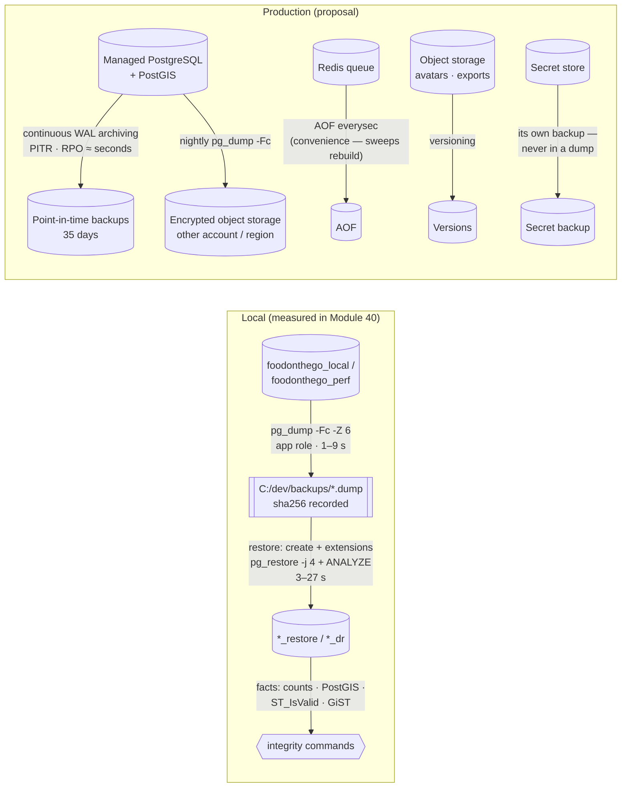
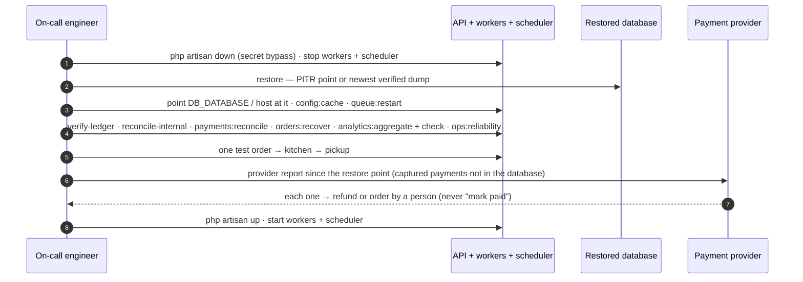

# Backup and disaster-recovery architecture (diagram)

Status: Module 40 — 2026-10-14 — local only; production = NO.
- The local shape (left in diagram 1) is what Module 40 ran and measured.
- The production shape is a proposal: PENDING BUSINESS APPROVAL of RPO / RTO and of the provider.

## 1. Backups

## 2. Recovery (runbook R1, `disaster-recovery.md`)

Measured locally (`m40-dr-exercise.json`, `m40-dr-exercise-first-run.txt`):
- **TEST RTO:** 22 s and 38.5 s from "primary lost" to the first order picked up on the restored database. This is the technical part only.
- **TEST RPO:** everything after the last dump (3 of 3 orders written after the backup were missing).
