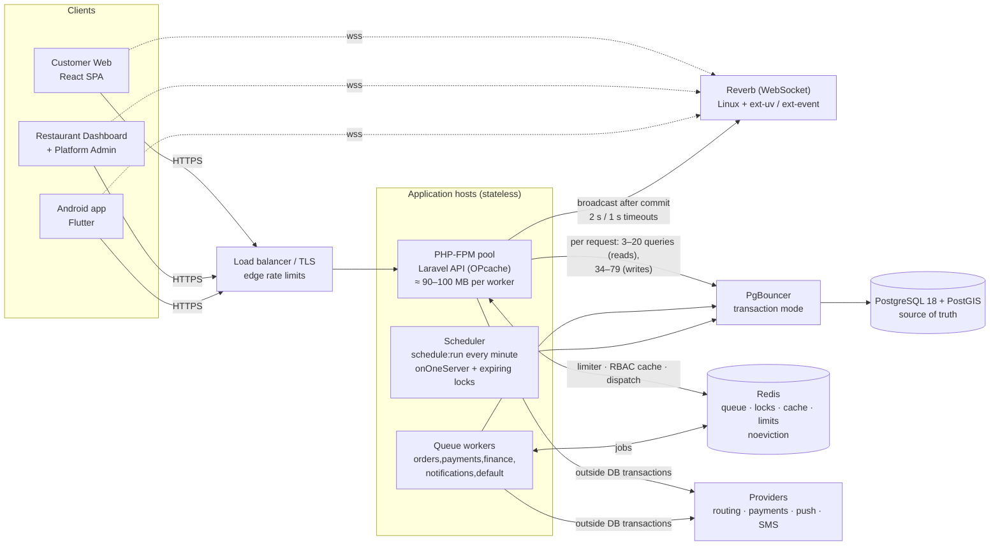
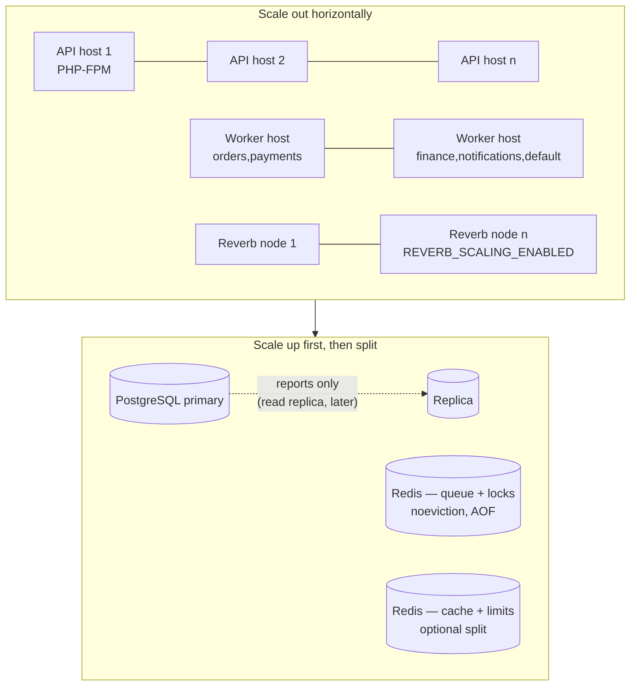

# Performance architecture (diagram)

Status: Module 40 — 2026-10-14 — local only; production = NO. Proposed production shape: PENDING BUSINESS / INFRASTRUCTURE APPROVAL.

## 1. Request path and where the time goes (measured locally, medium dataset)

| Hop | Measured locally (`m40-*.json`) | Lever |
|---|---|---|
| Opening a PostgreSQL connection per request | ≈ 30 ms per request; at 30 VUs p50 452 ms → 91 ms with persistent connections | **PgBouncer** (or persistent connections) |
| Redis connection per request | Windows client ports exhausted at ≈ 70 req/s (5 × 500) | persistent named Redis connections |
| Named prepared statements | 2 round trips per query (`DEALLOCATE`); −27 % DB time without them | `DB_PGSQL_DISABLE_PREPARES` / pooler support |
| Queueing for a PHP worker | server p95 150–520 ms vs client p95 1–7 s under saturation | pool size × CPU |
| Statement time | almost all < 5 ms; fixed: board 17 → 1.6 ms, admin list 16 → < 5, finance period 50 → 4, held lines 88 → 8 | indexes (CONCURRENTLY), query shape |
| Realtime | delivery p95 ≈ 300 ms from the request; 255-connection ceiling on Windows | Linux event loop; scaling via Redis |

## 2. Scaling units

