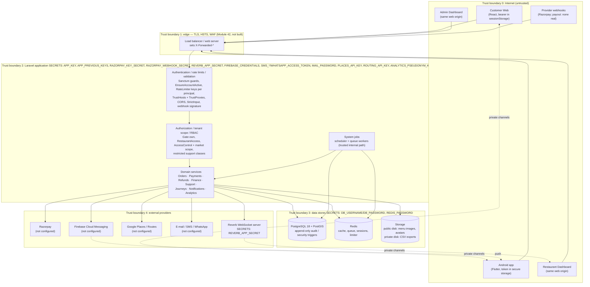
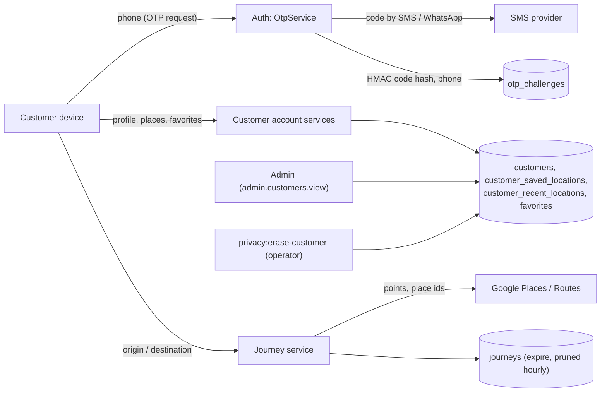
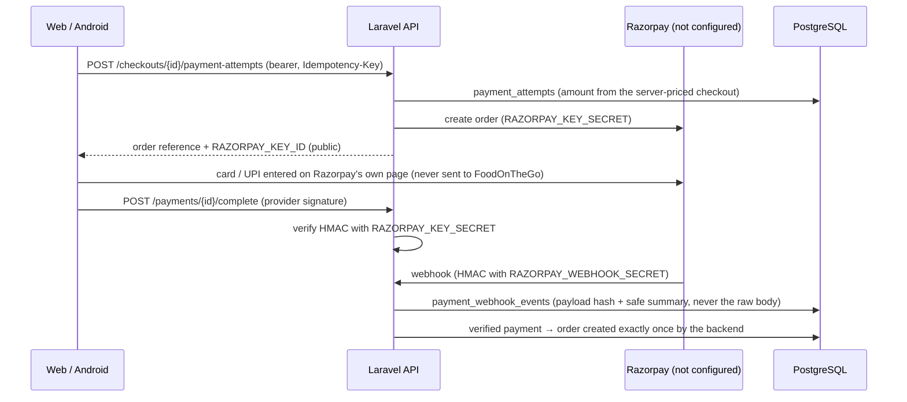
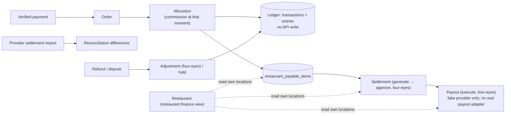
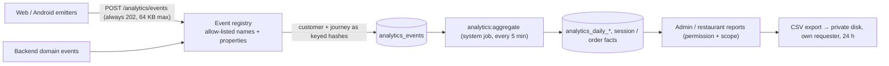
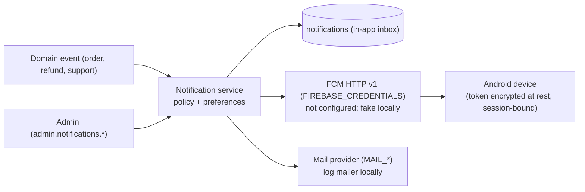

# Data flow and trust boundaries

Status: Module 39 — 2026-10-14 — local only; production = NO

Sources: `backend/routes/api.php`, `backend/routes/console.php`, `backend/routes/channels.php`, `backend/bootstrap/app.php`, `backend/app/Providers/AppServiceProvider.php`, `backend/config/{security,cors,services,notifications,payments,journey,finance,analytics,support,filesystems,database,reverb}.php`, `backend/app/Services/{Payment,Order,Notifications,Analytics,Privacy,Journey}/**`, `backend/app/Http/Resources/Order/OrderPresenter.php`, `backend/database/migrations/2026_10_19_100000_module39_security.php`, `docs/security/route-inventory.json`, `customer-web/src/api/client.ts`, `customer-web/src/security/contentSecurityPolicy.ts`, `mobile/android/app/src/main/AndroidManifest.xml`, `mobile/lib/auth/auth_repository.dart`.

Providers marked "not configured" are implemented in code but have no credentials and were never exercised: Razorpay (payments, refunds), FCM push, real e-mail, SMS / WhatsApp, Google Places / Routes. Locally the DEVELOPMENT (fake) providers run instead. No real payout provider exists.

## 1. Security architecture (spec section 390)

Each box is a trust boundary. "SECRETS:" marks a secret boundary: the secrets named there (by variable name, see `secret-management.md`) exist only on the server side of it.

Public values that cross boundary 0 by design: `RAZORPAY_KEY_ID`, `REVERB_APP_KEY` / `VITE_REVERB_APP_KEY`, any browser maps key.

## 2. Trust boundaries (spec section 8)

| Boundary | Who is trusted for what | Controls at the crossing | Code / test |
|---|---|---|---|
| Browser → API | Nothing in the request is trusted until validated; identity only from the bearer token | HTTPS (edge, not built); CORS exact origins, no credentials; bearer-only (no cookie, no CSRF surface); per-principal rate limits; strict validation; server-side prices / totals / status | `config/cors.php:19-35`; `AppServiceProvider.php:204-323`; `HardeningConfigTest`, `InjectionTest` |
| Android → API | Same as the browser; the app is a client like any other | Same API controls; release build requires an https API URL and API modes; no backup of app data; cleartext traffic off | `AndroidManifest.xml:21-24`; `mobile/lib/core/app_config.dart` (client report: 8 tests) |
| Razorpay → Webhook | Only a body whose HMAC matches `RAZORPAY_WEBHOOK_SECRET` | Signature over the raw body before anything is read; body size limit 64 KB; duplicate per event id and per signed body; the event never decides alone — the payment is re-read from the provider | `PaymentWebhookService.php:67-99`; `config/payments.php:60`; migration `:55`; `PaymentWebhookTest`, `DataProtectionTest::test_a_replayed_webhook_body_under_a_new_event_id_is_a_duplicate` |
| Firebase → App | FCM delivers a notice to the device; the app trusts it only as a hint and reads the order from the API | Push token bound to the session that registered it; sign-out / revocation / expiry unbinds it | migration `:57-62`; `CustomerDeviceService.php:70-72`; `DataProtectionTest::test_a_push_binding_ends_with_the_session_that_registered_it` |
| Restaurant staff → Restaurant API | A restaurant user only for locations of an ACTIVE membership, per permission | `auth:restaurant` + active; `RestaurantAccess::authorize` (404 not reached, 403 no permission); optional MFA; lockout | `RestaurantAccess.php:71-90`; `IsolationTest`, `TenantIdorMatrixTest` |
| Admin → Admin API | An administrator per permission and market | `auth:admin` + active; MFA required by default outside local / testing; idle timeout; four-eyes; reason on sensitive actions; audit | `config/auth_security.php:54-58`; `AppServiceProvider.php:133-146`; `AuthHardeningTest`, `PrincipalBoundaryTest` |
| Laravel → PostgreSQL | The application role | `DB_SSLMODE` must be require / verify-* in production; append-only triggers on audit / security trails (every environment except the LOCAL development database, whose browser suites remove their own audit rows — BUG-323; `security:check` fails where the triggers are missing); least-privilege role = deployment decision | `SecurityCheck.php:38`; migration `:38-49` |
| Laravel → Redis | Cache, queue, sessions, rate limiter only (no system of record) | Redis password required in production; no business data that is not also in PostgreSQL | `SecurityCheck.php:39` |
| Laravel → external providers | Provider answers are evidence, re-checked | Hosts from configuration only (no fetch-by-URL feature); test-mode Razorpay only (live keys refused, `allow_live` false); timeouts | `config/services.php`; `RazorpayPaymentProvider.php:129-131`; `config/payments.php:24` |
| Scheduler / queue → domain | Trusted internal code; no HTTP entry | Commands under one lock (`withoutOverlapping`); same domain services as the API | `routes/console.php:13-58` |

## 3. Customer data

| Item | Detail |
|---|---|
| Collected | Phone (sign-in), name, e-mail, birth date, gender, cuisines, avatar, saved / recent places, journeys |
| Leaves the platform | Phone to the SMS / WhatsApp provider; places and route points to Google (not configured) |
| Who reads | The customer (own); admins with `admin.customers.view` (market); restaurant staff see name and phone of their own orders only for `RESTAURANT_CONTACT_HOURS` (default 24) after the order ended, then masked (`OrderPresenter.php:519-533`) |
| Deletion | A deletion request sets status RESTRICTED: no new checkout or payment (`CheckoutService.php:82`, `PaymentService.php:72`). Erasure is an operator command, dry run by default (`PrivacyEraseCustomer.php:16`; `CustomerErasureService.php`). Self-service export and automatic erasure are NOT built |
| Retention | OTP challenges 7 days after expiry; phone-change requests 30 days after expiry (`model:prune`); others PENDING BUSINESS APPROVAL |

## 4. Payment data

| Item | Detail |
|---|---|
| Stored | Amounts, provider references, status, `method_summary` (network, card type, last4, masked VPA, bank / wallet code) — no PAN, CVV, UPI PIN or bank password (see `data-classification.md` §6) |
| Refused at the door | Card / PIN / bank fields in checkout and payment requests (`CheckoutController.php:121-123`, `PaymentController.php:93-95`) |
| Refunds | Requested, approved (four-eyes outside local / testing) and executed by admins with `admin.refunds.*`; provider confirms (`RefundService.php:201`) |
| Idempotent replies | Encrypted at rest; pruned after expiry (`IdempotencyKey.php:21-33`) |

## 5. Restaurant data

| Flow | Path | Control |
|---|---|---|
| Staff sign-in | e-mail + password (+ TOTP if enrolled) → token | Lockout per account (`AccountLockout.php:25-53`); MFA challenge serialised (`StaffLoginService.php:90`) |
| Profile, hours, menu, images | Restaurant Dashboard → `/restaurant/locations/*`, `/restaurant/menu/*` | Permission at location; images re-encoded, UUID names (`MenuImageService.php:65`) |
| Published data | → PUBLIC routes and media cache | Menu documents cached per host |
| Orders | Customer order → restaurant location queue → realtime `restaurant.location.{id}` channel | `restaurant.orders.view`; channel auth through the API route only |
| Pickup verification | Scanner at location → `/restaurant/pickup/verify` | Scanner location = order location; credential row locked (`PickupVerificationService.php:139`) |
| Staff management | Owner → invitations (SHA-256 token) | Whole-organization permission; never above own permissions; admin cannot add a second OWNER (`RestaurantOrganizationController.php:205`) |

## 6. Financial data

Controls: finance permissions + market (`rbac-matrix.md`); four-eyes defaults ON outside local / testing (`config/finance.php:130`, `:147`, `:166`; enforced `SettlementService.php:54`, `PayoutService.php:617`, `AdjustmentService.php:210`); payout destinations only as a provider token and mask (`module36_finance.php:546-549`); `live_enabled` false for payouts (`config/finance.php:145`).

## 7. Support data

| Flow | Detail |
|---|---|
| Customer / restaurant → case | `/customer/support/*`, `/restaurant/support/*`; requester derived from the token |
| Admin service desk | `/admin/support/*`; permission + market + restricted class (finance / security) |
| Internal notes | Separate table, never in a customer or restaurant API; `admin.support.notes` |
| Links to other domains | By reference; the linked record is shown only to a viewer who may read that domain |
| System cases | Opened by listeners and `support:sweep` (system job) |
| Attachments | **Not implemented** (`config/support.php:151-154`); malware scanning required before enabling |

## 8. Analytics data

No phone, e-mail, name, address, coordinate or route is stored in analytics (`config/analytics.php:48-67`; `Pseudonymizer.php:54-58`). The erasure command removes the customer key from events, session facts and order facts. A consent screen is not built (an opt-out flag exists) — legal documents are DRAFT.

## 9. Notification data

| Item | Detail |
|---|---|
| Stored | Title, body, data, delivery attempts (safe error only) |
| Push token | `encrypted` (`CustomerDevice.php:78`); unbound when the registering session ends |
| SMS notifications | Driver `off` by default (`config/notifications.php:27`) |
| Admin test send | `admin.notifications.test`; enabled only when `APP_ENV` is local or testing (`config/notifications.php`; changed from a deny-list to an allow-list after this review, so a staging environment never has it) |

## 10. Gaps

- Edge (TLS, HSTS, WAF, proxy topology) is not built; trusted proxies unverified.
- One web origin serves customer, restaurant and admin apps; separate origins are a deployment decision.
- Least-privilege PostgreSQL role, backups, monitoring: deployment (Modules 40–42).
- No flow above was exercised against a real provider.
