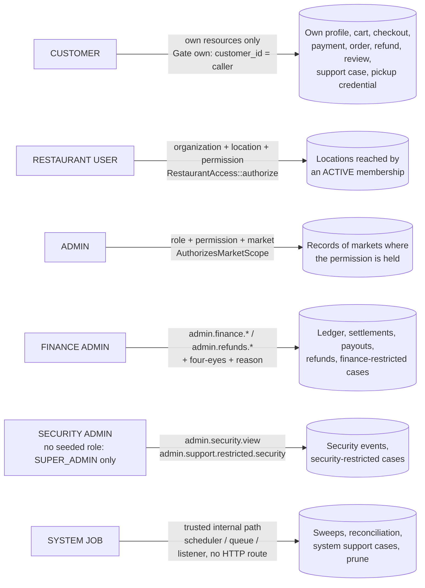

# RBAC master matrix

Status: Module 39 — 2026-10-14 — local only; production = NO

Sources: `backend/app/Enums/Permission.php`, `backend/database/seeders/RoleSeeder.php`, `backend/app/Providers/AppServiceProvider.php`, `backend/app/Auth/AccessControl.php`, `backend/app/Services/Restaurant/RestaurantAccess.php`, `backend/app/Http/Controllers/Api/Admin/Concerns/AuthorizesMarketScope.php`, `backend/app/Http/Middleware/EnsureAccountActive.php`, `backend/routes/api.php`, `docs/security/route-inventory.json`, Module 39 authorization tables (`authz_tables.md`), `backend/tests/Feature/Security/*`, `backend/tests/Feature/Rbac/*`.

Every role below is a default bundle of permissions. The role bundles are **PENDING BUSINESS APPROVAL**. The backend checks the permission, never the role name (`RoleSeeder.php:10-13`).

## 1. How access is decided

| Principal | Guard | What decides access | Code |
|---|---|---|---|
| Guest | none | Public routes only. A guest cart or journey is bound to its own token (`X-Cart-Token`, `X-Journey-Token` headers). | `routes/api.php`; `config/cors.php:28` |
| Customer | `auth:customer` + `active` | Ownership. Customers hold no permissions. The `own` gate allows a record only when its `customer_id` is the caller's. | `Permission.php:8`; `AppServiceProvider.php:173-175` |
| Restaurant user | `auth:restaurant` + `active` | Active membership of the organization, reach to the location, and the permission at that location scope. Not reachable = 404; reachable without permission = 403. | `RestaurantAccess.php:71-90`, `:108` |
| Admin user | `auth:admin` + `active` | Permission (route `can:` or `Gate`) and market scope of the role assignment. | `AppServiceProvider.php:157-171`; `AuthorizesMarketScope.php:21`, `:31` |
| System job | none (CLI / queue) | Scheduled commands, queue jobs and listeners run as trusted internal code. No HTTP route reaches them. | `routes/console.php:13-58` |

Common rules:

- `EnsureAccountActive` refuses a principal that cannot authenticate (403 `account_not_active`) and a token without the ACCESS ability (403 `mfa_enrollment_required`) (`EnsureAccountActive.php:24-43`).
- Every ability named like a catalogued permission goes to `AccessControl::allows()` for every caller (`AppServiceProvider.php:157-171`). A customer can never hold one.
- Grants are cached. The cache version changes only after the database transaction commits (`AccessControl.php:117-121`).
- A token of one principal type never opens another type's routes (pinned by `PrincipalBoundaryTest`).
- An administrator's token unused for `AUTH_ADMIN_IDLE_MINUTES` (default 60) is deleted on its next use (`AppServiceProvider.php:133-146`).

## 2. Route classes (`docs/security/route-inventory.json`, 422 method + route entries)

| Class | Routes | Rule |
|---|---|---|
| ADMIN | 204 | `auth:admin` + active; permission + market |
| RESTAURANT | 81 | `auth:restaurant` + active; organization + location + permission |
| CUSTOMER | 69 | `auth:customer` + active; owner-scoped |
| PUBLIC_OR_CUSTOMER | 19 | guest or customer (guest token / journey token bound) |
| PUBLIC | 15 | no sign-in; public data only |
| PUBLIC_AUTH | 13 | sign-in / recovery entry points; rate-limited |
| DEVELOPMENT_ONLY | 7 | registered only in local / testing (`routes/api.php:263-280`, `config/payments.php:21`) |
| ANY_PRINCIPAL | 5 | any signed-in principal; own session / account only |
| ANY_STAFF | 4 | restaurant or admin user; own account only (MFA, password) |
| HEALTH | 3 | `/health`, `/up`; `/ready` needs `admin.system.view` unless `API_READINESS_PUBLIC` |
| PROVIDER_WEBHOOK | 2 | no sign-in; provider signature over the raw body |

The inventory was generated locally, so the 7 DEVELOPMENT_ONLY routes appear in it. `RouteInventoryTest` fails when a registered route is missing from the inventory or breaks its class rule.

Known stale entry: the inventory (and `authz_tables.md`) still describe `GET /restaurant/orders/{order}/events` as "NONE (reach only)". The code now checks `restaurant.orders.view` at the order's location (`OrderEventsController.php:45-47`), pinned by `StaffAuthorizationHardeningTest::test_the_event_stream_of_an_order_needs_the_order_permission_at_its_location`. The inventory text should be regenerated.

## 3. Spec actors mapped to seeded roles

| Spec actor (section 19) | Seeded role code | Permissions | Note |
|---|---|---|---|
| Guest | — (no principal) | 0 | Public, PUBLIC_AUTH and PUBLIC_OR_CUSTOMER routes only |
| Customer | — (customer principal) | 0 | Ownership only; cannot be given roles (`RbacTest::test_customers_hold_no_permissions_and_cannot_be_given_roles`) |
| Restaurant Viewer | `VIEWER` | 7 | Read-only, plus restaurant analytics |
| Restaurant Staff | `ORDER_STAFF`; `MENU_MANAGER` | 8; 9 | No single "staff" role: order work and menu work are split |
| Restaurant Manager | `MANAGER` | 20 | All restaurant permissions except `restaurant.staff.manage` and `restaurant.payout_account.view` |
| Restaurant Owner | `OWNER` | 22 | All restaurant permissions |
| Admin Support | `SUPPORT_ADMIN` | 14 | |
| Admin Finance | `FINANCE_ADMIN` | 38 | Only role (besides SUPER_ADMIN) with refund, settlement, payout, ledger and finance-restricted case permissions |
| Admin Security | **no equal** | — | No seeded security role. `admin.security.view` and `admin.support.restricted.security` are held only by `SUPER_ADMIN`. |
| Admin Operations | `OPERATIONS_ADMIN` | 32 | |
| Super Admin | `SUPER_ADMIN` | 68 (all admin) | Platform administration only (`RoleSeeder.php:46`) |
| (not in spec) | `RESTAURANT_ONBOARDING` | 11 | Approves and manages restaurants |
| (not in spec) | `MODERATION_ADMIN` | 9 | Review moderation |
| (not in spec) | `ANALYST` | 15 | Read-only reporting and exports |

Catalogue size: 90 permissions = 22 `restaurant.*` + 68 `admin.*` (`Permission.php:12-135`).

## 4. Restaurant roles × permissions (`RoleSeeder.php:31-43`)

| Permission | OWNER | MANAGER | ORDER_STAFF | MENU_MANAGER | VIEWER |
|---|---|---|---|---|---|
| `restaurant.profile.view` | Y | Y | Y | Y | Y |
| `restaurant.profile.manage` | Y | Y | - | - | - |
| `restaurant.hours.manage` | Y | Y | - | - | - |
| `restaurant.pickup_settings.manage` | Y | Y | - | - | - |
| `restaurant.settings.manage` | Y | Y | - | - | - |
| `restaurant.menu.view` | Y | Y | Y | Y | Y |
| `restaurant.menu.manage` | Y | Y | - | Y | - |
| `restaurant.orders.view` | Y | Y | Y | Y | Y |
| `restaurant.orders.update` | Y | Y | Y | - | - |
| `restaurant.pickup.verify` | Y | Y | Y | - | - |
| `restaurant.reviews.view` | Y | Y | - | Y | Y |
| `restaurant.reviews.respond` | Y | Y | - | - | - |
| `restaurant.reviews.report` | Y | Y | - | Y | - |
| `restaurant.staff.view` | Y | Y | - | - | - |
| `restaurant.staff.manage` | Y | - | - | - | - |
| `restaurant.analytics.view` | Y | Y | - | - | Y |
| `restaurant.analytics.export` | Y | Y | - | - | - |
| `restaurant.notifications.view` | Y | Y | Y | Y | Y |
| `restaurant.finance.view` | Y | Y | - | - | - |
| `restaurant.payout_account.view` | Y | - | - | - | - |
| `restaurant.support.view` | Y | Y | Y | Y | Y |
| `restaurant.support.create` | Y | Y | Y | Y | - |

## 5. Admin roles × permissions (`RoleSeeder.php:50-66`)

SA = SUPER_ADMIN, OPS = OPERATIONS_ADMIN, ONB = RESTAURANT_ONBOARDING, SUP = SUPPORT_ADMIN, FIN = FINANCE_ADMIN, MOD = MODERATION_ADMIN, ANL = ANALYST.

| Permission | SA | OPS | ONB | SUP | FIN | MOD | ANL |
|---|---|---|---|---|---|---|---|
| `admin.restaurants.view` | Y | Y | Y | Y | Y | Y | Y |
| `admin.restaurants.approve` / `.manage` | Y | - | Y | - | - | - | - |
| `admin.restaurants.suspend` | Y | Y | - | - | - | - | - |
| `admin.customers.view` | Y | Y | - | Y | - | Y | - |
| `admin.customers.manage` | Y | Y | - | - | - | - | - |
| `admin.orders.view` | Y | Y | Y | Y | Y | Y | Y |
| `admin.orders.override` | Y | Y | - | - | - | - | - |
| `admin.orders.recover` | Y | Y | - | Y | - | - | - |
| `admin.payments.view` | Y | Y | - | Y | Y | - | Y |
| `admin.payments.reconcile` | Y | - | - | - | Y | - | - |
| `admin.refunds.view` | Y | Y | - | Y | Y | - | - |
| `admin.refunds.create` / `.approve` / `.issue` / `.reconcile` | Y | - | - | - | Y | - | - |
| `admin.disputes.view` | Y | - | - | - | Y | - | - |
| `admin.settlements.view`, `admin.finance.view` | Y | Y | - | - | Y | - | Y |
| `admin.finance.payouts.view`, `admin.finance.reconciliation.view` | Y | Y | - | - | Y | - | - |
| `admin.finance.commission.*`, `.settlements.manage/approve`, `.payouts.execute/record_external`, `.reconciliation.manage`, `.adjustments.create`, `.holds.manage`, `.ledger.view`, `.export` | Y | - | - | - | Y | - | - |
| `admin.reviews.view` | Y | Y | Y | Y | - | Y | Y |
| `admin.reviews.moderate` / `.restore` | Y | - | - | - | - | Y | - |
| `admin.reviews.reports.view` | Y | Y | - | - | - | Y | - |
| `admin.promotions.view` | Y | Y | - | - | - | - | Y |
| `admin.support.view` | Y | Y | Y | Y | Y | Y | - |
| `admin.support.manage` / `.assign` / `.notes` / `.escalate` | Y | Y | - | Y | Y | - | - |
| `admin.support.restricted.finance` | Y | - | - | - | Y | - | - |
| `admin.markets.view`, `.cities.view`, `.service_areas.view`, `.market_configuration.view` | Y | Y | Y | - | Y | - | Y |
| `admin.notifications.view` | Y | Y | - | Y | - | - | Y |
| `admin.notifications.manage` | Y | Y | - | Y | - | - | - |
| `admin.notifications.test` | Y | Y | - | - | - | - | - |
| `admin.audit.view` | Y | Y | - | - | Y | Y | - |
| `admin.analytics.view` | Y | Y | Y | - | Y | - | Y |
| `admin.analytics.export` | Y | Y | - | - | Y | - | Y |
| `admin.system.view` | Y | Y | - | - | - | - | Y |

Held only by SUPER_ADMIN (14): `admin.promotions.manage`, `admin.support.restricted.security`, `admin.markets.manage`, `admin.cities.manage`, `admin.service_areas.manage`, `admin.market_configuration.manage`, `admin.market_features.manage`, `admin.configuration.manage`, `admin.users.view`, `admin.users.manage`, `admin.roles.view`, `admin.roles.manage`, `admin.security.view`, `admin.settings.manage`.

## 6. Functional domain matrix

Scope keys: **own** = the customer's own records; **org+loc+perm** = active membership, location reach and the permission at that location (or organization for staff management); **perm+market** = permission held in the record's market (or platform-wide where noted). "—" = no route.

| Domain | Actor | READ | CREATE | UPDATE | DELETE | SPECIAL ACTIONS | Scope |
|---|---|---|---|---|---|---|---|
| Identity / sessions | Any principal | `GET auth/me`, `auth/sessions` | sign-in (PUBLIC_AUTH) | — | `DELETE auth/sessions/{id}` | logout, logout-all | own session / account |
| | Staff | — | MFA setup | `POST auth/password` | `DELETE auth/mfa/totp` | MFA confirm | own account |
| | Admin | `admin.users.view`, `admin.roles.view` | `admin.users.manage` (role within own permissions) | role: `admin.roles.manage`; status: `admin.users.manage` | — | MFA reset (`admin.users.manage`, reason, not self, not a superior: 403 `cannot_manage_superior`) | platform-wide only |
| Audit / security events | Admin | `admin.audit.view` (market list); `admin.security.view` | — | — | — (DB refuses UPDATE / DELETE) | — | perm+market; security = platform-wide |
| Markets & geography | Guest | markets, coverage, availability | — | — | — | — | public |
| | Admin | `admin.markets/cities/service_areas/market_configuration.view` | `.manage` variants | `.manage`, `admin.market_features.manage` (+reason) | — | availability check (`admin.service_areas.view`) | perm+market |
| Restaurants | Guest / Customer | published restaurants, menus, reviews | favorites (own) | — | favorites (own) | price quote | public / own |
| | Restaurant | `restaurant.profile.view`; staff: `restaurant.staff.view` | staff invite: `restaurant.staff.manage` | profile / hours / pickup settings / availability: matching `.manage` | images, special hours, staff | — | org+loc+perm; staff = whole organization, never above own permissions, last owner kept |
| | Admin | `admin.restaurants.view` | organizations, locations, notes, staff: `admin.restaurants.manage` | `admin.restaurants.manage` | staff membership (+reason) | status: approve / suspend / manage per transition; second OWNER refused (409 `organization_has_owner`) | perm+market (primary and target market) |
| Menus | Restaurant | `restaurant.menu.view` | categories, items, images: `restaurant.menu.manage` | same | same | reorder, duplicate, bulk status | org+loc+perm; ids limited to the menu |
| | Admin | `admin.restaurants.view` | — | — | — | — | perm+market |
| Cart / checkout | Guest | own cart (cart token) | cart items, journey, pickup selection | same | same | switch restaurant, refresh | guest token |
| | Customer | own cart, checkout | `POST checkouts` | promotion apply / remove | — | confirm, cancel, claim guest cart | own; RESTRICTED account refused (403 `account_restricted`) |
| Payments | Customer | `GET payments/{id}` | payment attempt | — | — | complete (signature check) | own; RESTRICTED refused |
| | Admin | `admin.payments.view` | — | — | — | reconcile (`admin.payments.reconcile`, reason) — no "mark as paid" | perm+market |
| Orders | Customer | own orders, events, pickup credential | (created only by the backend from a verified payment) | — | — | cancel (disabled: `ORDER_CUSTOMER_CANCELLATION_ENABLED=false`), reissue pickup credential | own |
| | Restaurant | `restaurant.orders.view` (list, detail, events) | — | accept / reject / start / ready: `restaurant.orders.update` | — | pickup verify: `restaurant.pickup.verify` at scanner AND order location | org+loc+perm; contact masked after `RESTAURANT_CONTACT_HOURS` |
| | Admin | `admin.orders.view` | — | — | — | cancel (`admin.orders.override`, reason); recover (`admin.orders.recover`) | perm+market |
| Refunds & disputes | Customer | own order's cancellation / refund state | — | — | — | — | own |
| | Admin | `admin.refunds.view`, `admin.disputes.view` | `admin.refunds.create` | approve / reject: `admin.refunds.approve` | — | execute / retry: `admin.refunds.issue`; reconcile: `admin.refunds.reconcile`; four-eyes | perm+market |
| Finance | Restaurant | `restaurant.finance.view` (earnings, settlements, payouts, terms); destination mask: `restaurant.payout_account.view` | — | — | — | CSV export (`restaurant.finance.view`, audited) | org+loc+perm |
| | Admin | `admin.finance.view`, `admin.settlements.view`, `.payouts.view`, `.reconciliation.view`, `.ledger.view`, `.commission.view` | commission plans, holds, adjustments, settlements (generate), provider settlement import | — | — | approve settlement, execute / retry / cancel payout, record external payout, resolve difference, four-eyes; nobody writes the ledger through the API | perm+market; some platform-wide only |
| Promotions / fee / tax rules | Admin | `admin.promotions.view`, `admin.market_configuration.view` | `admin.promotions.manage`, `admin.market_configuration.manage` | same (+reason) | — | status change (+reason) | perm+market |
| Reviews | Guest | published reviews | — | — | — | — | public |
| | Customer | own reviews | review of own completed order | own review | own review | report a review | own |
| | Restaurant | `restaurant.reviews.view` | response: `restaurant.reviews.respond` | same | — | report: `restaurant.reviews.report` | org+loc+perm |
| | Admin | `admin.reviews.view`, `.reports.view` | — | — | — | hide / publish / reject / assign / resolve: `.moderate`; restore: `.restore` | perm+market |
| Support | Customer | own cases, messages | case | message | — | close, reopen | own |
| | Restaurant | `restaurant.support.view` (+`restaurant.finance.view` for money cases) | `restaurant.support.create` | message | — | close, reopen | org+loc+perm; organization-level cases only for all-locations members |
| | Admin | `admin.support.view`; notes: `admin.support.notes` | case: `admin.support.manage` | status, priority, links, messages | — | assign, escalate, domain actions (need the domain's own permission) | perm+market + restricted class (`.restricted.finance` / `.restricted.security`) |
| Notifications | Customer | own inbox, devices | device (bound to the session) | preferences, device | device | mark read | own |
| | Admin | `admin.notifications.view` | test send (`admin.notifications.test`) | — | — | retry delivery (`admin.notifications.manage`) | perm, platform-wide only (a test send may target any customer by id) |
| Analytics & exports | Guest / Customer | — | events (`POST analytics/events`, always 202) | — | — | — | own pseudonymous key |
| | Restaurant | `restaurant.analytics.view` (+`restaurant.finance.view` for earnings) | export: `restaurant.analytics.export` | — | — | download (permission re-checked per location) | org+loc+perm; own exports only |
| | Admin | `admin.analytics.view` (+finance / support view for those reports) | export: `admin.analytics.export` + domain permission | — | — | download (re-checked per market) | perm+market; own exports only |
| System / health | Admin | `admin.system.view` (system cards, `/ready`) | — | — | — | — | platform-wide only |

## 7. Scope rules (spec sections 21–23)

### Customer — own records only

Profile, favorites, saved and recent locations, payment-method references, notification preferences, private journeys, cart, checkout, payment, order, refund state, review, notification, device, support case and pickup credential are all looked up through the signed-in customer. A record of another customer answers 404 and changes nothing. Pinned by `CustomerIdorMatrixTest` (every customer route with another customer's identifiers) and `IsolationTest::test_customer_a_cannot_read_customer_b_resources`.

### Restaurant — organization + location + role + permission

`RestaurantAccess::authorize()` first checks reach (active membership of the organization with all locations, or the location listed on the membership), then the permission at the location scope (`RestaurantAccess.php:80-90`). A scope sent by the client is ignored (`IsolationTest::test_scope_sent_by_the_client_is_ignored`). Staff management needs the permission for the whole organization (`RestaurantAccess.php:108`).

### Admin — role + permission + market + restricted class

`authorizeMarket()` and `marketsWith()` limit records to the markets where the caller holds the permission (`AuthorizesMarketScope.php:21-31`). A role assignment can be limited to one market (`RbacTest::test_an_admin_role_can_be_limited_to_a_market`). Some routes are platform-wide only (30 routes in the inventory). Restricted support cases also need `admin.support.restricted.finance` or `.security` (`Admin/SupportCaseController.php:578`). Finance figures in analytics show "restricted" without the finance permission.

## 8. RBAC diagram (spec section 391)

## 9. Tests that enforce the matrix

| Test | What it pins |
|---|---|
| `tests/Feature/Security/RouteInventoryTest.php` | Every registered route is in the inventory and keeps the rule of its class; dangerous framework routes are gone; dev routes only where fakes are allowed |
| `tests/Feature/Security/PrincipalBoundaryTest.php` | No protected route answers without a token; a token of one principal type never opens another type's routes; staff whose role holds no permission get nothing from any staff route |
| `tests/Feature/Security/CustomerIdorMatrixTest.php` | Customer A reaches nothing of customer B through any customer route |
| `tests/Feature/Security/TenantIdorMatrixTest.php` | Owner of one organization, staff of one location, admin of one market reach nothing of another (file added during Module 39; its passing run was not verified for this document) |
| `tests/Feature/Security/StaffAuthorizationHardeningTest.php` | No second OWNER by an admin; order event stream needs `restaurant.orders.view`; commission by plan only for permitted markets; grant cache flushed after commit |
| `tests/Feature/Auth/AdminUsersApiTest.php` | Permissions required platform-wide; no self-change; last full admin kept; role grant within own permissions; `cannot_manage_superior` |
| `tests/Feature/Rbac/RbacTest.php` | Roles are permission bundles; no default SUPER_ADMIN; immediate effect of changes; market-limited roles; customers hold no permissions; suspended accounts hold none; 401 / 403 / 200 pattern |
| `tests/Feature/Rbac/IsolationTest.php` | Cross-restaurant id swap; sibling location; permission required inside the right restaurant; client scope ignored; customers / admins on restaurant routes; admin without finance permission cannot issue a refund |
| Domain tests with negative checks | `Restaurant/RestaurantAuthorizationTest`, `Restaurant/RestaurantStaffTest`, `Menu/MenuAuthorizationTest`, `Geo/MarketScopeTest`, `Finance/AdminFinanceApiTest`, `Finance/RestaurantFinanceApiTest`, `Finance/PayoutTest`, `Finance/SettlementTest`, `Checkout/AdminPromotionApiTest`, `Support/SupportDeskTest`, `Support/SupportRestaurantCaseTest`, `Support/SupportDomainAuthorityTest`, `Support/SupportHardeningTest`, `Order/RealtimeOrderEventsTest`, `Pickup/PickupOwnershipTest`, `Cart/CartOwnershipTest`, `Journey/JourneyAccessTest`, `Payment/AdminPaymentApiTest`, `Review/ReviewSecurityTest`, `Refund/RefundSecurityTest`, `Analytics/AnalyticsScopeTimeCurrencyTest` |

## 10. Gaps and open items

| Item | Status |
|---|---|
| No dedicated security admin role; security views only through SUPER_ADMIN | Role design PENDING BUSINESS APPROVAL |
| Admin step-up (recent re-authentication) for high-risk actions | NOT implemented — production blocker |
| Restaurant MFA not required by default (`AUTH_MFA_REQUIRED_RESTAURANT` default false, `config/auth_security.php:59`) | Policy PENDING BUSINESS APPROVAL |
| SEC-42 small items (404 vs 403 existence oracle on admin detail, staff of a suspended organization keep access, realtime subscriptions survive revocation) | Open; not re-verified in this document |
| `route-inventory.json` permission text for `GET /restaurant/orders/{order}/events` | Stale (code is fixed); regenerate |
